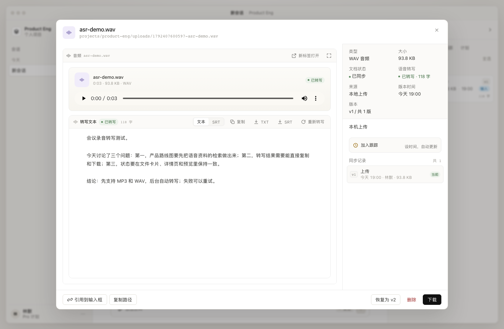

# 语音转写（ASR）

> 状态：已实现。上传 MP3 / WAV 后自动进入后台转写队列；文件卡片、详情页、音频预览共用同一套状态；预览可播放原音频并阅读、复制、下载转录文本。

## 1. 为什么需要三段式

17zhiling 的语音转写接口只接收**公网可访问的音频 URL**，不接收文件流：

```
本地音频 blob
   │
   ├─① GET  /api/upload/signature         申请 S3 上传签名
   ├─② POST <uploadUrl> (multipart)       上传到临时桶，得到 fileUrl
   ├─③ POST /api/asr/parse-audio-url-time 提交任务，得到 taskId
   └─④ GET  /api/asr/task-status          每 4 秒轮询，直到 SUCCESS / FAIL
```

Workbench 绑定在 `127.0.0.1`，外部无法访问，所以不能把本地文件地址直接交给 ASR 服务。签名上传是官方提供的“把文件变成公网 URL”的方式，原始音频仍只存在本地 blob 中，转写完成后也只保存文本，不依赖临时桶长期可用。

## 2. 状态机（唯一真源）

状态由服务端 `lib/asr-status.mjs` 统一定义，通过 `material.asr` 随资料 DTO 发给前端；文件卡片、详情页、预览头部和 SSE 都读同一份数据，不在前端各写一套文案。

| status | 文案 | tone | 进度 | 含义 |
| --- | --- | --- | --- | --- |
| `idle` | 未转写 | neutral | 0% | 还没有开始（历史音频 / 手动开始前） |
| `queued` | 排队中 | live | 8% | 已进入本机后台队列 |
| `preparing` | 准备中 | live | 14% | 读取 blob、申请上传签名 |
| `uploading` | 上传音频 | live | 28% | 上传到临时桶 |
| `submitting` | 提交任务 | live | 44% | 提交到 ASR 接口 |
| `waiting` | 等待处理 | live | 55% | 远端 `WAIT_HANDLE` |
| `processing` | 转写中 | live | 72% | 远端 `ING` |
| `done` | 已转写 | ok | 100% | 有全文 / SRT |
| `failed` | 转写失败 | bad | 100% | 远端失败、超时或本地异常，可重试 |
| `unconfigured` | 未配置密钥 | warn | 0% | 没有 `ASR_API_KEY`；配置后显示为可开始 |
| `paused` | 已暂停 | warn | 0% | 密钥被移除等导致轮询暂停；恢复时优先续查原 taskId |
| `unsupported` | 不支持转写 | neutral | 0% | 非 MP3/WAV；仍可播放 |
| `disabled` | 转写未启用 | neutral | 0% | 服务端 `ASR=0` |

`active=true` 的状态（queued → processing）会显示进度条并自动轮询；`done` / `failed` 是终态。

## 3. 配置

写在 `.env.local`（或进程环境）：

```bash
ASR_API_KEY=你的智凌密钥
# 可选
ASR_API_BASE=https://api.17zhiling.com
# ASR=0   # 关闭语音转写；音频仍可上传和播放
```

- 也兼容 `ZHILING_API_KEY` 作为 `ASR_API_KEY` 的别名。
- 修改后需要重启 `npm start`；密钥不会下发到浏览器。
- 没有密钥时上传仍然成功，会记录一条 `unconfigured` 状态，音频可正常播放。

## 4. 接口

| 方法 | 路径 | 说明 |
| --- | --- | --- |
| GET | `/api/materials/:id/asr` | 最新版本的完整状态 + 全文 + SRT |
| GET | `/api/materials/:id/versions/:v/asr` | 指定版本的状态 + 全文 + SRT |
| POST | `/api/materials/:id/asr` | 开始 / 重试；body `{version?, force?}` |
| GET | `/api/materials/:id/versions/:v/asr/content?format=txt\|srt` | 下载转录文本 |
| GET | `/api/health` | `asr: { enabled, configured, apiBase }` |

`POST` 返回 `202 { ok, asr }`；`force: true` 会重新提交并再次计费，前端会二次确认。

列表和 SSE 里的 `material.asr` 只包含状态摘要（不含全文），避免每次资料刷新都搬运几万字；全文只在打开音频预览时按版本拉取。

## 5. 后台执行与恢复

`lib/asr.mjs` 的 `AsrService` 每个项目一个实例：

- **上传队列**：默认并发 2，串行完成“签名 → 上传 → 提交”，避免同时上传多个大文件。
- **轮询**：单次 tick 最多处理 4 个到期任务；建议间隔 4 秒，和官方建议的 3–5 秒一致。
- **持久化**：`asr_tasks` 按 `(workspace_id, blob_sha256)` 存储。同一段音频重复上传或恢复历史版本时直接复用已有结果，不会重复计费。
- **重启恢复**：
  - `preparing/uploading/submitting` → `failed`（提交结果未知，不自动重投，避免重复扣费）；
  - `waiting/processing` 且有 `task_id` → 保留并立即恢复轮询；
  - `queued` → 继续执行；
  - 已有 `done` 记录直接复用。
- **错误重试**：网络/HTTP 错误按 8s → 60s 退避；连续 20 次失败才转为 `failed`。整体超时 60 分钟。
- **取消**：服务关闭时 `AbortController` 中断在途请求。

## 6. 预览

`app.js` 的 `mountAudio`：

- 原生 `<audio controls>` 播放所选版本的不可变 blob，支持 Range / 拖动进度。
- 右侧/下方是 ASR 面板：状态、进度、全文、SRT 切换、复制、下载 TXT / SRT、重新转写。
- 状态通过 SSE 实时更新；预览内还有 4 秒兜底轮询。
- SSE 更新时**不会重建 audio 元素**，只刷新文本区，播放不会中断。
- 非 MP3/WAV 音频仍可播放，但 ASR 面板会说明“只支持 MP3 / WAV”。

## 7. Agent 工具

启用 ASR 时注册 `asr_read`：

```text
asr_read(path, mode?="auto", maxChars?=30000)
```

- `transcript`（默认）：全文；
- `srt`：字幕；
- `summary`：状态、字数、开头；
- 未完成时返回当前状态和进度，提示稍后再读，不会猜测音频内容。

系统提示要求 Agent 读取 `.mp3/.wav` 时使用 `asr_read`，不要用内置 `read` 读二进制。

## 8. 边界

- ASR 接口只支持 **MP3 / WAV**；M4A、AAC、FLAC、OGG 等可以播放，但不转写。
- 单文件上传上限：音频 120 MB，其它资料 30 MB。
- 音频仍会被上传到 17zhiling 的临时 S3 桶；如果对数据出境/第三方存储敏感，请关闭 `ASR=0`。
- 目前只做轮询，没有使用 `callbackUrl`（本机没有公网回调地址）。
- 转写文本存在 SQLite，单条上限 200 万字符；不做说话人分离。
- 删除资料是软删除，`asr_tasks` 会保留；如需彻底清理，删 `data/` 或手动清理对应 `blob_sha256`。

## 9. 验证

```bash
npm run test:asr       # 本地 mock：签名 → 上传 → 提交 → 轮询 → 成功/失败/重试
npm start
curl -s localhost:8080/api/health | jq .asr
curl -s localhost:8080/api/materials | jq '.[].asr? // empty'
```

UI 手工验证：

1. 上传 `.wav` / `.mp3`，文件卡片立即出现“排队中”，无需保持弹窗；
2. 打开预览，原音频可播放；
3. 状态从准备中 → 上传 → 提交 → 等待 → 转写中 → 已转写；
4. 完成后可切换文本 / SRT、复制、下载；
5. 失败时面板出现错误和“重试转写”；重试成功后恢复全文；
6. 关闭再打开预览，状态与文件卡片一致。


