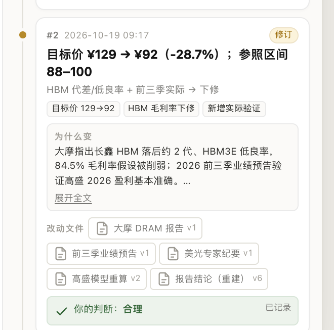
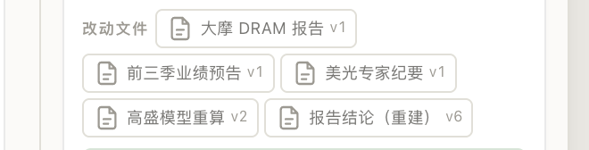
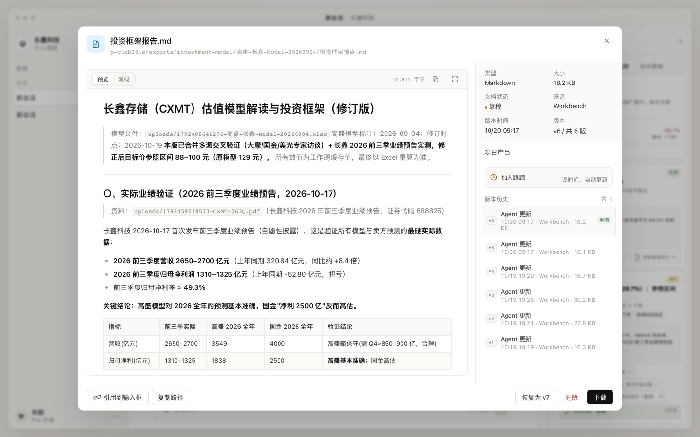

# 模型追踪：操作手册

> 面向投研、产品和使用者。前面只讲三件事：**怎么看、怎么判断、怎么定位到改动文件**。技术说明放在最后。
> 截图来自真实项目长鑫科技（p-c1db281e）。

## 1. 一分钟看懂

模型追踪是一条按时间排列的模型变化记录：

```text
#1 生成  高盛基准 ¥129
#2 修订  ¥129 → ¥92
#3 检查  证据核验，目标价未变
#4 提案  归母口径：¥88–100 → ¥55–85   ← 待你判断
```

每一条只回答三个问题：

1. **变了什么**：标题和变化标签，通常带目标价、区间或关键假设。
2. **为什么变**：数据、假设、口径或人工判断。
3. **改了哪些文件**：报告、模型、研报、公告；点一下就能打开对应文件。

人只需要做一个动作：对最近一次真正改了估值的变化，选择 **偏高 / 合理 / 偏低**。

> 最重要的区分：**提案不等于已生效**。提案只是"建议这么改"，只有采纳并写入主报告/模型后，才会改变当前目标价。

## 2. 打开追踪

右栏点击 **追踪**：


顶部先看三件事：

| 位置 | 含义 |
|---|---|
| 当前目标价 | 已经生效的结论；提案不会改变它 |
| 4 次变化 | 从第一次生成到现在一共留下几条记录 |
| 从 2026-09-04 开始 | 追踪起点 |

当前示例：`#4` 是归母口径提案（88–100 → 55–85），但当前目标价仍是 **¥92**，因为提案还没有被采纳。

## 3. 一条记录怎么看



| 区域 | 你要看什么 |
|---|---|
| `#2` + 时间 | 第几次变化、发生在什么时候 |
| `生成 / 修订 / 提案 / 人工确认` | 这条记录的性质 |
| 标题 | 一句话结论，通常带目标价变化 |
| 变化标签 | 目标价、毛利率、口径等关键变化 |
| **为什么变** | 原因与依据；内容长时可以「展开全文」 |
| **改动文件** | 这次变化涉及哪些文件；点开可以核对 |
| **你的判断** | 你已经做过的判断和状态 |

### 3.1 四种标签

| 标签 | 意思 | 你要做什么 |
|---|---|---|
| **生成** | 第一次建立模型/报告的基线 | 通常只需要知道起点 |
| **修订** | 已经生效的模型/报告变化 | 看原因、核对文件，判断偏高/合理/偏低 |
| **提案** | 只是建议，主报告/模型还没改 | 先判断是否合理，再决定是否采纳 |
| **人工确认** | 你确认过的调整 | 看结果，通常不需要再判断 |

### 3.2 先看结论，再看原因

以 `#2` 为例：

- **结论**：目标价 ¥129 → ¥92（-28.7%），参照区间 88–100。
- **原因**：大摩指出 HBM 落后约 2 代、HBM3E 低良率，84.5% 毛利率假设被削弱；前三季业绩预告验证高盛 2026 盈利基本准确。
- **文件**：大摩 DRAM 报告、前三季业绩预告、美光专家纪要、高盛模型重算、报告结论。

结论告诉你"变了多少"，原因告诉你"为什么变"，文件告诉你"去哪里核对"。

## 4. 人工怎么判断

### 4.1 三个选项

| 选项 | 你的意思 | 系统会怎么理解 |
|---|---|---|
| **偏高** | 模型给高了，实际应该更低 | 需要一次调整确认，确认后才让 Workbench 下调 |
| **合理** | 基本接受这次结论 | 记录判断；如果是提案，会再问是否采纳 |
| **偏低** | 模型给低了，实际应该更高 | 需要一次调整确认，确认后才让 Workbench 上调 |

可以在理由里补一句你的保留意见，例如：

- "Mi 65% 偏保守，建议按 H2 实测 72%"
- "区间上沿 85 可以接受，下沿 55 太低"
- "临港 HBM 归属未确认，先按 60–85"

这句话会跟着判断一起留在追踪里，后续复盘能看到你当时为什么这么判。

### 4.2 判断前 30 秒检查清单

1. **结论变了吗**：目标价、区间、评级有没有变？
2. **原因是什么**：是新数据、假设变化，还是口径/方法变化？
3. **改了哪些文件**：点开文件，确认版本和时间对得上。
4. **我的判断是什么**：偏高、合理还是偏低？有没有要补充的保留意见？

不要只看标题就点。标题是结论，原因和文件才是依据。

### 4.3 判断之后会发生什么

- **合理**：普通变化直接记录；提案会多一步「认可提案 → 采纳 / 只记录」。
- **偏高 / 偏低**：出现二次确认「确认调整 / 先不改」。
- 二次确认是安全闸门：**不是每一次点击都会改文件**。你可以借这一步再看一眼原因和文件。


## 5. 每次判断的效果

| 你的操作 | 追踪里显示 | 接下来发生什么 |
|---|---|---|
| 合理（普通修订） | 合理 · 已记录 | 只记录，不改模型 |
| 合理 + 提案 + 只记录 | 合理 · 已记录 | 提案保留，主报告/模型不动 |
| 合理 + 提案 + 确认采纳 | 合理 · 已采纳 | Workbench 把提案写入主报告/模型；稍后新增一条「修订」生效记录 |
| 偏高/偏低 + 确认调整 | 偏高/偏低 · 已确认调整 | Workbench 按方向重新调整；稍后新增一条生效记录 |
| 偏高/偏低 + 先不改 | 偏高/偏低 · 暂不调整 | 保留判断，文件不动 |

### 5.1 提案的「采纳 / 只记录」


选择「合理」后，按钮变成「认可提案」。点击后出现：

```text
确认把这份提案写入主投资框架报告、估值模型和 analysis-state.json？
[确认采纳] [只记录判断] [返回]
```

- **确认采纳**：判断变成「合理 · 已采纳」，Workbench 开始把提案写入主报告和模型。写入完成后，追踪里会出现一条新的「修订」记录，告诉你实际改成了什么。
- **只记录判断**：判断变成「合理 · 已记录」，提案保留，文件不动。适合"方向认可，但参数还要再核实"的情况。


### 5.2 判断后还能再判断吗

一条变化只允许判断一次。判断后，这条记录会显示你的结论，不再重复弹出判断卡。

如果之后出现新的变化（新的修订、新的提案），追踪会再出现新的判断卡。你不需要主动去找，右侧和对话区会自动更新。

## 6. 怎么定位影响修改的文件

这是操作手册里最实用的一部分。

### 6.1 先看「改动文件」



每条记录底部都有「改动文件」：

```text
改动文件
[大摩 DRAM 报告 v1] [前三季业绩预告 v1] [美光专家纪要 v1]
[高盛模型重算 v2]   [报告结论（重建） v6]
```

每个文件标签包含：

- **文件名**：例如"报告结论（重建）"。
- **版本号**：例如 `v6`，表示这条变化对应的是第 6 版。

文件名告诉你"改了什么"，版本号告诉你"改的是哪一版"。

### 6.2 点开文件核对

点击任意文件标签，会打开文件面板：



这里可以完成四件事：

| 区域 | 用途 |
|---|---|
| 路径 | 确认文件在项目里的位置 |
| 预览 | 直接读正文/表格，不用下载 |
| 版本历史 | 看 v1–v6 每一版的时间和大小，点某一版可预览 |
| 底部按钮 | 引用到输入框、复制路径、恢复历史版本、下载 |

### 6.3 定位文件的四步法

1. **看「为什么变」**：原因里通常会点名关键材料，例如"大摩指出 HBM 落后约 2 代"。
2. **找对应文件标签**：例如"大摩 DRAM 报告 v1"。
3. **点开**：确认路径、版本、时间是否和这条记录一致。
4. **核对关键数字**：报告看目标价/区间，模型看假设/单元格，公告看原文。

如果一条记录没有文件标签，通常是纯人工判断或口径说明；这时以「为什么变」和你的判断记录为准。

### 6.4 文件类型怎么读

| 文件类型 | 看什么 |
|---|---|
| 估值模型 `.xlsx` | 关键假设、目标价单元格、重算后的输出 |
| 投资框架报告 `.md` | 结论、目标价区间、观点和依据 |
| 分析状态文件 | 系统维护的状态；通常不用手动看，排查问题时可对照 |
| 研报/公告 `.pdf` | 原文、页码、发布日期；用于核对证据 |

### 6.5 一个例子

`#2` 目标价 129 → 92：

- 想知道"为什么降"：看「为什么变」，点名大摩报告和前三季业绩。
- 想知道"报告改成什么"：点「报告结论（重建）」，看到 `投资框架报告.md` v6，正文里目标价区间 88–100。
- 想知道"模型改了什么"：点「高盛模型重算」或到右栏 `产出` 里打开模型文件，核对假设和输出。
- 想对比旧版：在文件面板的版本历史里点 v5，和 v6 对照。

## 7. 提案、采纳与二次确认

### 7.1 为什么会有提案

当 Workbench 只写出了方案/分析文件，还没有改主报告或模型时，追踪会记成 **提案**。

提案是"建议"，不是"已经发生"。所以：

- 当前目标价不会因为提案而改变；
- 你可以先判断方向（偏高/合理/偏低）；
- 认可后再决定是否采纳。

### 7.2 采纳与调整的区别

| 动作 | 适用 | 结果 |
|---|---|---|
| 认可提案 → 确认采纳 | 提案方向、参数都可接受 | Workbench 写入主报告/模型，之后新增生效记录 |
| 认可提案 → 只记录判断 | 方向认可，但还想再核实 | 提案保留，文件不动 |
| 偏高/偏低 → 确认调整 | 方向不对，需要重新调 | Workbench 按你的方向重新调整 |
| 偏高/偏低 → 先不改 | 只是记录判断 | 文件不动 |

### 7.3 二次确认为什么必要

估值模型的变化会影响目标价、评级和后续判断。二次确认让你在真正改文件前，再看一眼：

- 我选的是偏高还是偏低？
- 理由写清楚了吗？
- 这次是采纳提案，还是只记录？
- 文件版本对不对？

## 8. 移动端

手机/窄屏下，判断卡纵向排列，右栏通过抽屉打开：


操作和桌面一致：先选偏高/合理/偏低，再记录；提案会多一步采纳确认。

## 9. 常见问题

**为什么现在没有判断卡？**

按顺序检查：

1. 最近有没有新的、真正改了估值的变化？
2. 这条变化是不是已经判断过了？
3. 最近一条是不是"目标价未变"的检查点？
4. 最近一条是不是"人工确认"记录？

如果都不满足，就不会弹卡。可以在右栏「追踪」里查看历史。

**为什么当前目标价还是 92？**

因为 `#4` 是提案，还没有被采纳。只有「确认采纳」并让 Workbench 写入主报告/模型后，当前目标价才会更新。

**提案标题写 55–85，方案正文写 60–85，听谁的？**

这是需要你判断的地方。可以：

- 选「偏高/偏低」表达方向；
- 或选「合理」，在理由里写"按 60–85 采纳"；
- 或先「只记录判断」，等参数核实后再采纳。

**判断错了能改吗？**

目前界面没有"改判"按钮。需要改判时，只能重置这条追踪（会清空该项目的追踪和判断历史），或重新补录一次会话。重置前请确认。

**为什么有的记录没有文件？**

有些变化是人工判断、口径说明或检查点，不一定对应文件。这时看「为什么变」和判断记录即可。

**提案和修订有什么区别？**

- **提案**：建议，主报告/模型还没改；当前目标价不变。
- **修订**：已经生效，文件已经改过；当前目标价可能已变。

**怎么看更早的历史？**

右栏「追踪」按时间从上往下排列，向上滚动即可看更早的记录；每条都可以展开原因、点开文件。

## 10. 使用建议

1. **先看原因，再看文件，最后判断**。不要只看标题。
2. **提案先别急着采纳**。如果参数没核实，选「只记录判断」更稳。
3. **用理由留下保留意见**。例如"Mi 65% 偏保守""临港 HBM 归属待核"。
4. **点开文件核对版本**。版本号和时间对不上时，先不要判断。
5. **把「提案」和「修订」分开看**。提案不改变当前目标价。

---

## 11. 技术说明（实现与维护）

> 以下内容面向实现/维护，不影响前面的操作。

### 11.1 数据模型

| 表 | 作用 |
|---|---|
| `trace_entries` | 追加式追踪条目：`seq`、`at`、`kind`、`title`、`summary`、`reason`、`files_json`、`changes_json`、`source_json` |
| `trace_judgments` | 人工判断：`entry_id`、`verdict`、`note`、`status`、`prompt`、`adjustment_entry_id` |

`kind`：`generated` / `revised` / `proposed` / `adjustment` / `updated` / `branch` / `checkpoint`。

`status`：`pending_confirmation` / `recorded` / `confirmed` / `cancelled` / `adopted`。

### 11.2 判断状态机

```text
proposed ──合理 + 采纳──► adopted ──agent 写入──► revised
    │
    ├──合理 + 只记录──► recorded
    │
    └──偏高/偏低──► pending_confirmation ──确认调整──► confirmed + adjustment
                                      └──先不改──► cancelled

revised ──合理──► recorded
        └──偏高/偏低──► pending_confirmation ...
```

### 11.3 Run 结算钩子

```text
agent_start
  → 清空本次 run 的 changedFiles
tool_execution_end (write / edit)
  → 记录相对路径
agent_settled
  → onRunSettled(entry, { changedFiles, aborted, runId })
  → ctx.trace.recordRun({ sessionId, runId, changedFiles, text })
  → 追加 proposed / revised，或跳过
  → 广播 trace.updated
  → 前端自动 reload 追踪 + HITL
```

### 11.4 判定规则

| 本次 run 写了什么 | 结果 |
|---|---|
| 主报告 `投资框架报告.md` | `revised`（生效；有目标价信号才触发判断） |
| 模型 `.xlsx/.xlsm` | `revised` |
| `analysis-state.json`，且文本/标题有目标价变化 | `revised` |
| 只写了估值/归母/模型类方案、专题、TSV | `proposed`（提案） |
| 普通格式更新 | 可能记录为 `revised`，但不触发判断 |
| 非主报告/模型/状态/方案文件 | 跳过 |
| run 被中止 | 跳过 |
| 同一 `runId` 已记录 | 跳过 |

### 11.5 焦点规则

判断卡只针对**最近一条真正改了估值的变化**：

- `generated`、`proposed` 算；
- `revised` 且标题/原因/变更里出现「目标价」算；
- 明确写「目标价未变/不变」不算；
- `adjustment`、`updated`、`branch`、`checkpoint` 不算；
- 只看最近一条，不回头问更早的未判断条目。

### 11.6 API

```text
GET  /api/trace/current
POST /api/trace/entries/:id/judge       { verdict: high|fair|low, note, adopt? }
POST /api/trace/judgments/:id/confirm   { action: adjust|cancel }
POST /api/trace/record                  { sessionId, runId, changedFiles, text, at? }
POST /api/trace/current/reset           重新从旧卡/文件播种（开发与测试用）
```

### 11.7 历史、补录与重置

- 第一次打开：有旧判断卡时按阶段播种；没有则以最新模型/报告为起点。
- 补录旧会话：

```bash
node scripts/backfill-trace.mjs --project p-c1db281e --session <session-id>
node scripts/backfill-trace.mjs --project p-c1db281e --session <session-id> --apply
```

- 重置（开发/测试）：

```bash
curl -X POST 'http://127.0.0.1:8099/api/trace/current/reset?project=p-c1db281e'
```

### 11.8 文件清单

| 文件 | 作用 |
|---|---|
| [lib/trace/service.mjs](../lib/trace/service.mjs) | 播种、视图、判断、采纳、run 检测、prompt |
| [server/routes/trace.mjs](../server/routes/trace.mjs) | `/api/trace` 路由 |
| [store.mjs](../store.mjs) | `trace_entries` / `trace_judgments` 表与读写 |
| [server/agent/event-bridge.mjs](../server/agent/event-bridge.mjs) | 收集 write/edit，settle 回调 |
| [server/create-app.mjs](../server/create-app.mjs) | `maybeRunSettled` + `trace.updated` 广播 |
| [ui/trace/panel.js](../ui/trace/panel.js) | 右栏时间线 |
| [ui/trace/hitl.js](../ui/trace/hitl.js) | 判断 / 采纳 / 确认 |
| [ui/trace/trace.css](../ui/trace/trace.css) | 追踪与 HITL 样式 |
| [scripts/backfill-trace.mjs](../scripts/backfill-trace.mjs) | 补录旧会话 |
| [scripts/test-trace.mjs](../scripts/test-trace.mjs) | 服务层测试 |
| [scripts/test-trace-hook.mjs](../scripts/test-trace-hook.mjs) | settle 钩子测试 |
| [scripts/test-trace-e2e.py](../scripts/test-trace-e2e.py) | 浏览器 E2E |

### 11.9 验收

```bash
npm run test:trace        # 服务层 + settle 钩子
npm run test:trace:e2e    # 浏览器：真实数据 + run 钩子 + 提案 + 采纳 + 调整 + 移动端
python3 scripts/test-e2e.py
node scripts/test-server-modules.mjs
node scripts/test-approvals.mjs
```

当前结果：

- trace E2E：7/7
- 主应用 E2E：15/15
- server modules：11/11
- approvals：19/19

### 11.10 当前边界

- 追踪记录的是语义变化，不是每一次文件保存。
- 被中止的 run 不追加条目；用补录脚本处理。
- 当前目标价优先读 `analysis-state.json` 的 `V1`，否则回退旧卡结论。
- 采纳/调整由 agent 执行；追踪负责记录决定、差异和文件，不直接写工作簿。
