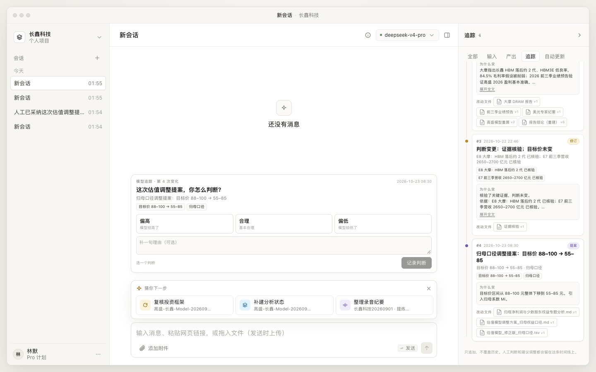
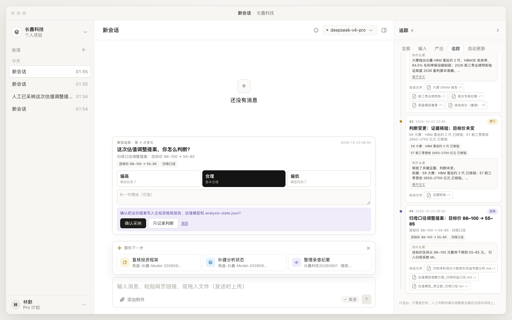
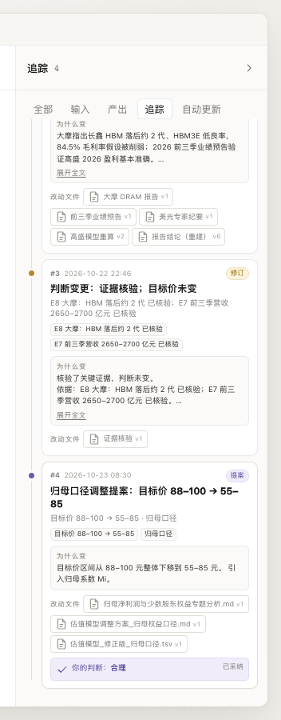
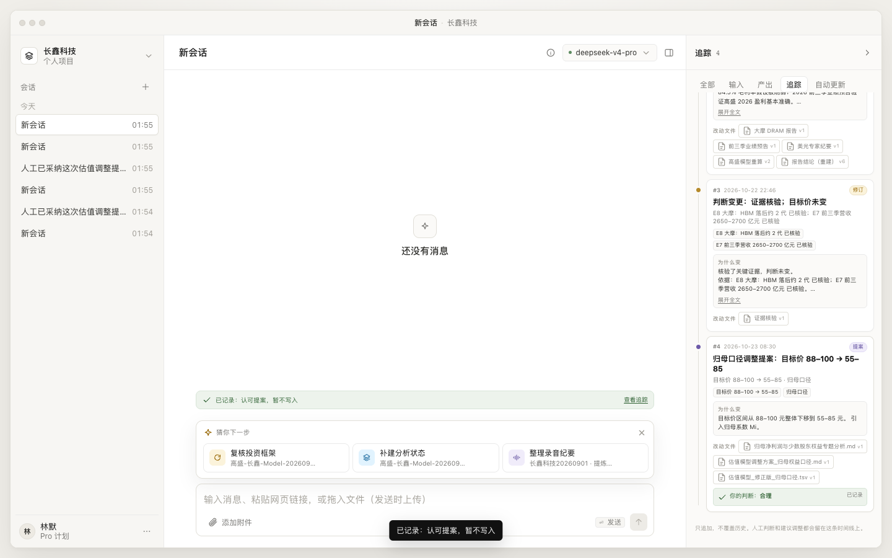
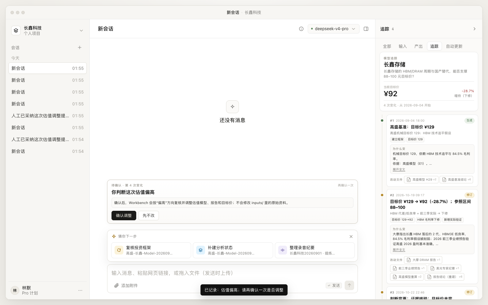
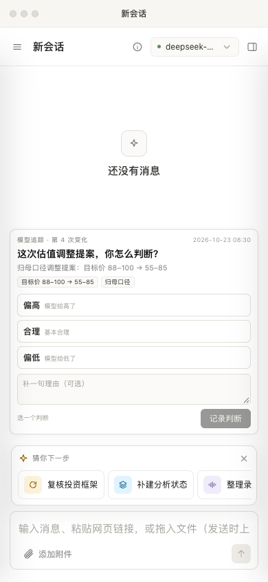

# 模型追踪：功能、实现与使用说明

> 状态：已实现并接入 Workbench（2026-10-23）。本文是使用与实现说明；设计取舍见 [model-trace.md](model-trace.md)。
> 目标读者：投研、产品、前端、后端。

## 1. 一句话

**估值模型从第一次生成开始，每次变化追加一条记录；每条只回答三件事：变了什么、为什么变、改了哪些文件。**

人机交互只保留一个动作：对最近一次真正改了估值的变化，选择 **偏高 / 合理 / 偏低**。

```text
#1 生成  高盛基准 ¥129
#2 修订  ¥129 → ¥92
#3 检查  证据核验，目标价未变
#4 提案  归母口径：¥88–100 → ¥55–85   ← 待你判断
```

当前目标价仍是 **¥92**；`#4` 是提案，尚未写入主报告和模型。这是追踪里最重要的区分：**提案不等于生效**。

---

## 2. 快速上手

1. 打开项目，点击右栏 **追踪**。
2. 看最近一条真正改了估值的变化；对话区会出现判断卡。
3. 选择 **偏高 / 合理 / 偏低**，可写一句理由。
4. 合理 → 记录；提案会再问一次「认可提案 → 采纳 / 只记录」。
5. 偏高 / 偏低 → 二次确认「确认调整 / 先不改」。

---

## 3. 界面与使用

### 3.1 打开追踪

右栏 tab 现在是：

```text
全部 / 输入 / 产出 / 追踪 / 自动更新
```

`追踪` 是模型变化历史；`自动更新` 是原来的跟踪契约，负责后台定时更新。`判断卡` 和 `计划` 已移除。



一条记录包含：

| 区域 | 含义 |
|---|---|
| `#4` + 时间 | 顺序编号和语义时间 |
| `提案` / `生成` / `修订` / `人工确认` | 变化类型 |
| 标题 | 一句话结论，通常带关键数字 |
| 变化标签 | 目标价区间、口径、EPS 等 |
| **为什么变** | 原因与依据；过长可展开 |
| **改动文件** | 点击可打开对应资料 |
| **你的判断** | 已判断时显示结论和状态 |

`当前目标价` 只反映**已经生效**的结论；提案不会改变它。

### 3.2 判断一次变化

对话区底部是项目级 HITL，不跟某个会话绑定：

> **这次估值，你怎么判断？**
> 偏高（模型给高了） / 合理（基本合理） / 偏低（模型给低了）

可选填一句理由，然后点「记录判断」。

- **合理**：普通变化直接记录，不改模型。
- **偏高 / 偏低**：进入二次确认，不会立刻改文件。

### 3.3 提案：认可与采纳

当一次 agent run 只写了方案/分析文件、没写主报告或模型时，追踪会记成 **提案**。判断卡会多一步：



选择「合理」后，按钮变成「认可提案」。点击后出现：

```text
确认把这份提案写入主投资框架报告、估值模型和 analysis-state.json？
[确认采纳] [只记录判断] [返回]
```

- **确认采纳**：判断状态变为「已采纳」，自动把写入 prompt 发给 Workbench；agent 写完主报告/模型后，下一次 run 结算会再追加一条 `revised` 生效记录。
- **只记录判断**：提案保留，文件不动；追踪里显示「合理 · 已记录」。

采纳后的追踪：



只记录判断：



### 3.4 偏高 / 偏低：二次确认

如果认为这次估值偏高或偏低：



```text
你判断这次估值偏高
确认后，Workbench 会按“偏高”方向复核并调整估值模型、报告和目标价。
[确认调整] [先不改]
```

- **确认调整**：追加「已确认调整」条目，并把调整 prompt 发给 agent；agent 下一次写主报告/模型时，结算钩子会再追加生效记录。
- **先不改**：保留判断，不改文件。

### 3.5 判断后的追踪

判断会挂在对应变化上，右侧显示：

```text
你的判断：偏低 · 已确认调整
你的判断：合理 · 已采纳
你的判断：偏高 · 暂不调整
```

一条变化只允许判断一次。目前 UI 没有「改判」入口；需要改判时，只能重置追踪（会清空判断历史）或重新补录一次会话。

### 3.6 移动端

判断卡在 390px 下纵向排列，右栏通过抽屉打开：



---

## 4. 自动写入：run 结算钩子

这是追踪能“自己长出来”的关键。

```text
agent_start
  → 清空本次 run 的 changedFiles
tool_execution_end (write / edit)
  → 记录相对路径
agent_settled
  → onRunSettled(entry, { changedFiles, aborted, runId })
  → ctx.trace.recordRun({ sessionId, runId, changedFiles, text })
  → 追加 proposed / revised，或跳过
  → 广播 trace.updated
  → 前端自动 reload 追踪 + HITL
```

对应实现：

| 位置 | 作用 |
|---|---|
| [event-bridge.mjs](../server/agent/event-bridge.mjs) | 收集一次 run 的 write/edit 路径，在 settle 时回调 |
| [create-app.mjs](../server/create-app.mjs) | `maybeRunSettled` 调用 `ctx.trace.recordRun` 并广播 |
| [service.mjs](../lib/trace/service.mjs) | 判断本次 run 是提案、生效，还是跳过 |
| [panel.js](../ui/trace/panel.js) | 右栏时间线 |
| [hitl.js](../ui/trace/hitl.js) | 判断 / 采纳 / 二次确认 |

### 4.1 判定规则

| 本次 run 写了什么 | 结果 |
|---|---|
| 主报告 `投资框架报告.md` | `revised`（生效；有目标价信号才触发判断） |
| 模型 `.xlsx/.xlsm` | `revised` |
| `analysis-state.json`，且文本/标题有目标价变化 | `revised` |
| 只写了估值/归母/模型类方案、专题、TSV | `proposed`（提案） |
| 普通格式更新 | 可能记录为 `revised`，但没有目标价信号，不触发判断 |
| 非主报告/模型/状态/方案文件 | 跳过 |
| run 被中止 | 跳过 |
| 同一 `runId` 已记录 | 跳过 |

纯排版类报告更新会进入历史，但不会弹判断卡；被中止的 run 可以用补录脚本处理。

### 4.2 为什么只追加，不覆盖

追踪表是 append-only：

- 旧条目永远不改写；
- 判断只新增 `trace_judgments` 行；
- 采纳/调整会新增 `adjustment` 或 `revised` 条目；
- 因此可以清楚看到「当时怎么判断 → 后来怎么改」。

---

## 5. 数据模型

### 5.1 `trace_entries`

| 字段 | 说明 |
|---|---|
| `id` / `workspace_id` | 条目与项目 |
| `seq` | 项目内顺序号，从 1 开始 |
| `at` | 语义时间（不是入库时间） |
| `kind` | `generated` / `revised` / `proposed` / `adjustment` / `updated` / `branch` / `checkpoint` |
| `title` | 一句话结论 |
| `summary` | 摘要 |
| `reason` | 为什么变 |
| `files_json` | 改动文件列表（materialId / path / version） |
| `changes_json` | 关键变化标签 |
| `source_json` | 来源：旧卡阶段、文件基线、agent run、判断等 |

### 5.2 `trace_judgments`

| 字段 | 说明 |
|---|---|
| `entry_id` | 判断针对哪条变化 |
| `verdict` | `high` / `fair` / `low` |
| `note` | 一句话理由 |
| `status` | `pending_confirmation` / `recorded` / `confirmed` / `cancelled` / `adopted` |
| `prompt` | 采纳或调整时发给 agent 的 prompt |
| `adjustment_entry_id` | 确认调整后追加的条目 |

### 5.3 状态机

```text
proposed ──合理 + 采纳──► adopted ──agent 写入──► revised
    │
    ├──合理 + 只记录──► recorded
    │
    └──偏高/偏低──► pending_confirmation ──确认调整──► confirmed + adjustment
                                      └──先不改──► cancelled

revised ──合理──► recorded
        └──偏高/偏低──► pending_confirmation ...
```

### 5.4 焦点规则

判断卡只针对**最近一条真正改了估值的变化**：

- `generated` 算；
- `proposed` 算；
- `revised` 且标题/原因/变更里出现「目标价」算；
- 明确写「目标价未变/不变」不算；
- `adjustment`、`updated`、`branch`、`checkpoint` 不算；
- 只看最近一条，不回头问更早的未判断条目。

所以 `ST2 证据核验（目标价未变）` 不会触发判断；`#4 归母口径提案` 会。

---

## 6. API

```text
GET  /api/trace/current
POST /api/trace/entries/:id/judge       { verdict: high|fair|low, note, adopt? }
POST /api/trace/judgments/:id/confirm   { action: adjust|cancel }
POST /api/trace/record                  { sessionId, runId, changedFiles, text, at? }
POST /api/trace/current/reset           重新从旧卡/文件播种（开发与测试用）
```

### 6.1 读取

```bash
curl -s 'http://127.0.0.1:8099/api/trace/current?project=p-c1db281e' | python3 -m json.tool
```

返回：

```json
{
  "subject": "长鑫存储",
  "current": { "target": 92, "previousTarget": 129, "delta": "-28.7%" },
  "entries": [],
  "focus": { "id": "…", "seq": 4, "kind": "proposed" },
  "pendingJudgment": null
}
```

### 6.2 判断

```bash
curl -X POST 'http://127.0.0.1:8099/api/trace/entries/<entry-id>/judge?project=p-c1db281e' \
  -H 'content-type: application/json' \
  -d '{"verdict":"fair","note":"Mi 65% 可接受"}'
```

提案「合理 + 采纳」：

```json
{ "verdict": "fair", "adopt": true, "note": "按 60–85 采纳" }
```

返回会带 `adoption.prompt`，由前端发送给 agent。

### 6.3 二次确认

```bash
# 偏高/偏低确认调整
curl -X POST 'http://127.0.0.1:8099/api/trace/judgments/<id>/confirm?project=p-c1db281e' \
  -H 'content-type: application/json' -d '{"action":"adjust"}'

# 先不改
... -d '{"action":"cancel"}'
```

### 6.4 外部 run 结算

服务端内部钩子直接调用 `trace.recordRun`；外部 agent 可以通过 HTTP 结算：

```bash
curl -X POST 'http://127.0.0.1:8099/api/trace/record?project=p-c1db281e' \
  -H 'content-type: application/json' \
  -d '{
    "sessionId": "s-1",
    "runId": "r-1",
    "changedFiles": ["exports/…/估值模型调整方案_归母权益口径.md"],
    "text": "目标价区间从 88–100 元整体下移到 55–85 元。"
  }'
```

---

## 7. 历史、补录与重置

### 7.1 第一次打开

- 如果项目有旧判断卡：把 `judgment_cards` 里的阶段按时间映射成追踪条目；
- 没有旧卡：以最新估值模型/投资框架报告为起点，生成一条「生成」记录；
- 之后再按 run 结算追加。

旧卡只是**迁移种子**，不是运行时依赖。

### 7.2 补录旧会话

钩子上线前已经结束的会话：

```bash
node scripts/backfill-trace.mjs --project p-c1db281e --session <session-id>
node scripts/backfill-trace.mjs --project p-c1db281e --session <session-id> --apply
```

脚本会从 Pi JSONL 读取 write/edit 路径和最终 assistant 文本，再走同一套 `recordRun` 判定。

### 7.3 重置

仅开发/测试使用：

```bash
curl -X POST 'http://127.0.0.1:8099/api/trace/current/reset?project=p-c1db281e'
```

会清空该项目的追踪和判断，然后重新从旧卡/文件播种。

---

## 8. 文件清单

| 文件 | 作用 |
|---|---|
| [lib/trace/service.mjs](../lib/trace/service.mjs) | 播种、视图、判断、采纳、run 检测、prompt |
| [server/routes/trace.mjs](../server/routes/trace.mjs) | `/api/trace` 路由 |
| [store.mjs](../store.mjs) | `trace_entries` / `trace_judgments` 表与读写 |
| [server/agent/event-bridge.mjs](../server/agent/event-bridge.mjs) | 收集 write/edit，settle 回调 |
| [server/create-app.mjs](../server/create-app.mjs) | `maybeRunSettled` + `trace.updated` 广播 |
| [ui/trace/panel.js](../ui/trace/panel.js) | 右栏时间线 |
| [ui/trace/hitl.js](../ui/trace/hitl.js) | 判断 / 采纳 / 确认 |
| [ui/trace/trace.css](../ui/trace/trace.css) | 追踪与 HITL 样式 |
| [scripts/backfill-trace.mjs](../scripts/backfill-trace.mjs) | 补录旧会话 |
| [scripts/test-trace.mjs](../scripts/test-trace.mjs) | 服务层测试 |
| [scripts/test-trace-hook.mjs](../scripts/test-trace-hook.mjs) | settle 钩子测试 |
| [scripts/test-trace-e2e.py](../scripts/test-trace-e2e.py) | 浏览器 E2E |

---

## 9. 常见问题

**为什么现在不弹判断卡？**

按顺序检查：

1. 项目有追踪记录吗？
2. 最近一条真正改了估值的变化存在吗？
3. 这条变化是否已经判断过？
4. 最近一条是不是「目标价未变」的检查点，或 `adjustment`？

当前项目 `#4` 提案未判断，所以会弹；`#2` 已判为合理，`#3` 目标价未变，都不会再问。

**为什么当前目标价还是 92？**

`#4` 是提案，不是生效变化。只有「确认采纳」并让 agent 写入主报告/状态文件后，`current` 才会更新。`current` 优先读 `analysis-state.json` 的 `V1`，没有则回退旧卡结论。

**提案标题写 55–85，方案正文写 60–85，听谁的？**

这就是需要人判断的地方。可以在判断卡里选「偏高/偏低」，或选「合理」后在备注里写「按 60–85 采纳」。追踪只记录你的决定，不替你选参数。

**会不会每次文件保存都记一条？**

不会。只在 run 结算时按语义筛选：主报告、模型、状态文件、估值/归母类方案文件；普通格式更新可能进入历史但不触发判断，非相关文件和中止 run 跳过。

**判断错了能改吗？**

目前没有 UI 改判入口。只能重置追踪（会清空判断历史）或重新补录。后续可以在判断行加「改判」。

---

## 10. 验收

```bash
npm run test:trace        # 服务层 + settle 钩子
npm run test:trace:e2e    # 浏览器：真实数据 + run 钩子 + 提案 + 采纳 + 调整 + 移动端
python3 scripts/test-e2e.py
node scripts/test-server-modules.mjs
node scripts/test-approvals.mjs
```

当前结果：

- trace E2E：7/7
- 主应用 E2E：15/15
- server modules：11/11
- approvals：19/19
