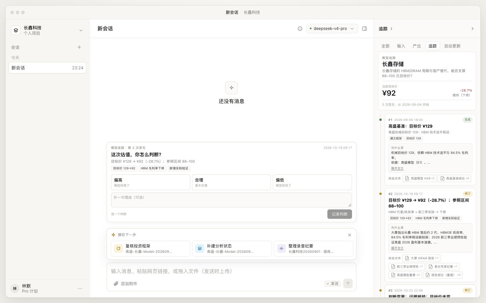
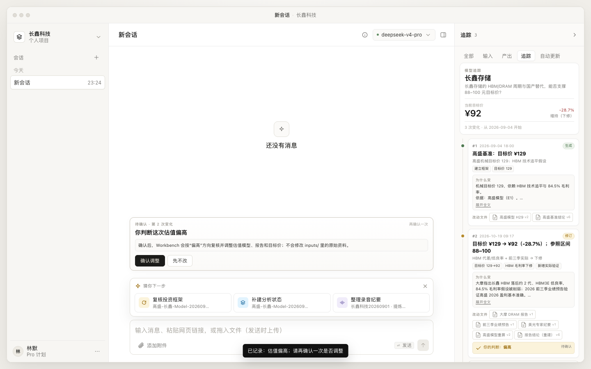
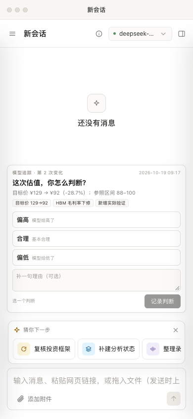

# 模型追踪：一条按顺序变化的估值模型历史

> 状态：已实现（2026-10-22）。替代判断卡的阶段/审阅/提案结构；右侧栏「追踪」是唯一历史视图，对话区只保留一次简单判断。
> 使用与实现说明（含截图、逐步操作）：[model-trace-guide.md](model-trace-guide.md)。
> Word 版：[模型追踪-功能实现与使用说明.docx](模型追踪-功能实现与使用说明.docx)。

## 1. 一句话

**估值模型从第一次生成开始，每次变化追加一条记录；每条只回答三件事：变了什么、为什么变、改了哪些文件。**

判断卡里的观点、证据、推理、阶段、审阅不再要求人逐条处理。人只在关键变化上做一个直白判断：

```text
这次估值，你怎么判断？
[偏高]  [合理]  [偏低]
```

## 2. 一条追踪长什么样

```text
#1  2026-09-04 18:00  生成
    高盛基准：目标价 ¥129
    为什么变：机械目标价 129，依赖 HBM 技术追平与 84.5% 毛利率。
    改动文件：高盛模型 H29 v2 · 高盛基准结论 v6

#2  2026-10-19 09:17  修订
    目标价 ¥129 → ¥92（-28.7%）
    为什么变：大摩指出 HBM 落后约 2 代、HBM3E 低良率，毛利率假设被削弱。
    改动文件：大摩 DRAM 报告 v1 · 前三季业绩预告 v1 · 高盛模型重算 v2 · 报告结论 v6
    你的判断：偏低 · 已确认调整
```

数据结构：

```json
{
  "seq": 2,
  "at": "2026-10-19T01:17:00.000Z",
  "kind": "generated | revised | updated | adjustment | ...",
  "title": "目标价 ¥129 → ¥92（-28.7%）",
  "summary": "HBM 代差/低良率 + 前三季实际 → 下修",
  "reason": "为什么变：……\n依据：……",
  "files": [{ "materialId": "…", "name": "投资框架报告.md", "path": "exports/…", "version": 6 }],
  "changes": ["目标价 129→92", "HBM 毛利率下修"],
  "source": { "type": "card_stage", "stageId": "ST1" }
}
```

## 3. 历史从哪来

| 来源 | 行为 |
|---|---|
| 旧判断卡 | 首次读取时把 `judgment_cards` 里的阶段按时间映射成追踪条目；这是迁移，不是运行时依赖 |
| 没有旧卡 | 以最新的估值模型 / 投资框架报告文件为起点，生成一条「生成」记录 |
| 人工判断 | `trace_judgments` 表；偏高/偏低先待确认，合理直接记录 |
| 确认调整 | 追加一条 `adjustment` 条目，并把调整请求发给 Workbench 对话 |

追踪是**追加**的：不覆盖、不合并旧条目；修改历史只能通过新增一条记录表达。

## 4. HITL：一次判断 + 一次确认

1. 焦点 = 最近一条真正改了估值的变化（`目标价 … 未变` 的检查点不会触发判断）。
2. 人选 **偏高 / 合理 / 偏低**，可写一句理由。
3. **合理**：普通变化只记录；`proposed` 提案会先问「认可提案」，再二次确认「采纳并写入主报告/模型」。
4. **偏高 / 偏低**：先记录判断，再显示一次确认：
   - **确认调整**：追加「已确认调整」条目，并把一段调整 prompt 发给 Workbench；由 agent 复核模型、报告和 `analysis-state.json`。
   - **先不改**：保留判断，不触发调整。
5. 判断会附在对应变化上；右侧追踪显示「你的判断：偏高 · 已确认调整 / 暂不调整 / 已采纳」。

### 提案与生效

- agent run 结算时，如果只写了方案/分析文件、没写主报告或模型，追加 `proposed`（提案）。
- 如果写了主报告/模型，或状态文件里出现目标价变化，追加 `revised`（生效）。
- `proposed` 被采纳后：判断状态为 `adopted`，并向 agent 发送写入 prompt；agent 写主报告/模型后，结算钩子再追加一条 `revised`。
- 追踪里因此能区分「提案」和「已生效」，未采纳的 60–85 不会冒充当前目标价。

## 5. API

```text
GET  /api/trace/current                     当前项目的追踪视图
POST /api/trace/entries/:id/judge           { verdict: high|fair|low, note, adopt? }
POST /api/trace/judgments/:id/confirm       { action: adjust|cancel }
POST /api/trace/record                      { sessionId, runId, changedFiles, text, at? }
POST /api/trace/current/reset               重新从旧卡/文件播种（开发与测试用）
```

`adopt: true` 只对 `proposed` + `fair` 生效：记录为 `adopted`，返回 `adoption.prompt`，由前端发给 agent 写入。

`/api/trace/record` 是给宿主/外部 agent 的结算入口；服务端内部的 run 结算钩子直接调用 `trace.recordRun`，不需要走 HTTP。

`GET` 返回：

```json
{
  "subject": "长鑫存储",
  "current": { "target": 92, "previousTarget": 129, "delta": "-28.7%", "rating": "增持（下修）" },
  "entries": [],
  "focus": { "id": "…", "seq": 2 },
  "pendingJudgment": null,
  "summary": { "total": 3, "firstAt": "…", "lastAt": "…" }
}
```

## 6. 界面

- 右栏 tab：`全部 / 输入 / 产出 / 追踪 / 自动更新`。
  - `追踪`：模型变化历史（本功能）。
  - `自动更新`：原有跟踪契约，保留为后台自动更新的管理入口。
  - `计划` 与 `判断卡` tab 已移除。
- 对话区 `#traceHitl`：
  - 判断卡：三个选项 + 可选理由 + 记录判断。
  - 提案卡：认可提案 → 二次确认「确认采纳 / 只记录判断」。
  - 确认卡：确认调整 / 先不改。
  - 完成条：一句结果 + 「查看追踪」。








## 7. 文件

| 文件 | 作用 |
|---|---|
| `store.mjs` | `trace_entries` / `trace_judgments` 表与读写方法 |
| `lib/trace/service.mjs` | 播种、视图、判断、二次确认、采纳、run 结算检测、调整 prompt |
| `server/routes/trace.mjs` | `/api/trace` 路由 |
| `server/agent/event-bridge.mjs` | 收集一次 run 的 write/edit 路径，settle 时交给钩子 |
| `server/create-app.mjs` | `maybeRunSettled`：调用 `ctx.trace.recordRun` 并广播 `trace.updated` |
| `server/project-context.mjs` | 每个项目创建 `ctx.trace` |
| `ui/trace/panel.js` | 右栏追踪时间线 |
| `ui/trace/hitl.js` | 对话区判断 / 采纳 / 确认 / 完成条 |
| `ui/trace/trace.css` | 追踪与 HITL 样式 |
| `scripts/test-trace.mjs` | 服务层测试（含 run 检测与采纳） |
| `scripts/test-trace-hook.mjs` | agent settle 钩子测试 |
| `scripts/test-trace-e2e.py` | 浏览器 E2E（真实项目数据 + run 钩子 + 移动端） |
| `scripts/backfill-trace.mjs` | 把已结束的旧会话补录进追踪 |

## 8. 已验证

```bash
npm run test:trace
npm run test:trace:e2e
```

- 真实项目 `p-c1db281e` 从旧卡播种出 3 条：ST0 基准 129、ST1 修订 129→92、ST2 证据核验（目标价未变）。
- 焦点落在 ST1（最近一次真正改估值的变化），ST2 不会触发判断。
- 判断「偏高」→ 二次确认 → 先不改：判断挂到 ST1，历史仍是 3 条。
- 判断「偏低」→ 确认调整：追加「已确认调整」，并向对话发送调整 prompt。
- 单次旧会话补录（`c8f2d568…`）：归母口径提案 `proposed`，`目标价 88–100 → 55–85`，焦点指向该提案。
- 提案「合理」→「认可提案」→「确认采纳」：判断状态 `adopted`，发送写入 prompt；只记录则不发送。
- agent run 结算钩子：写入 `exports/估值模型调整提案.md` + 最终文本含目标价变化 → 自动追加 `proposed`；E2E 已验证。
- 移动端 390px 无横向溢出，HITL 可见。

## 9. 当前边界

- 追踪记录的是**语义变化**：agent run 结算时检测 write/edit 涉及的主报告、模型、状态文件，以及估值/归母类方案文件；不会为每一次普通文件写入都生成条目。
- 纯格式/排版类报告更新（没有目标价/估值/EPS/归母等信号）会被跳过。
- 被中止（aborted）的 run 不追加条目；需要时用 `scripts/backfill-trace.mjs` 补录。
- 「当前目标价」优先读 `analysis-state.json` 的 `V1`，否则回退旧卡结论；提案本身不会改变当前目标价，只有采纳后 agent 写入主报告/状态文件才会。
- 采纳/调整由 agent 执行；追踪负责记录决定、差异和文件，不直接写工作簿。
