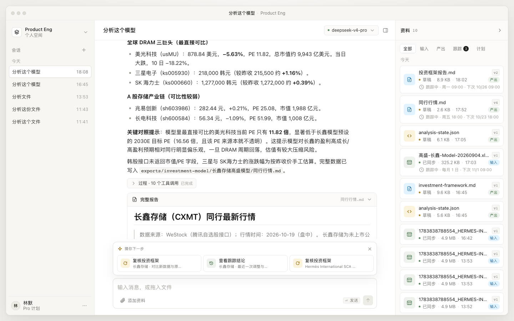
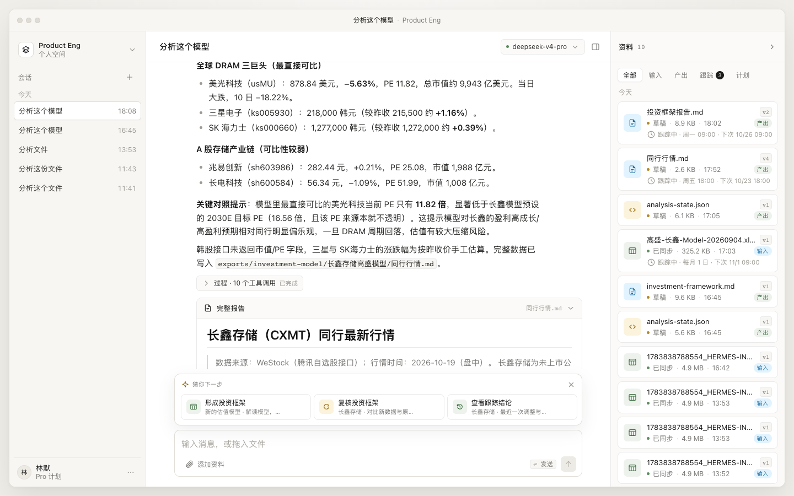
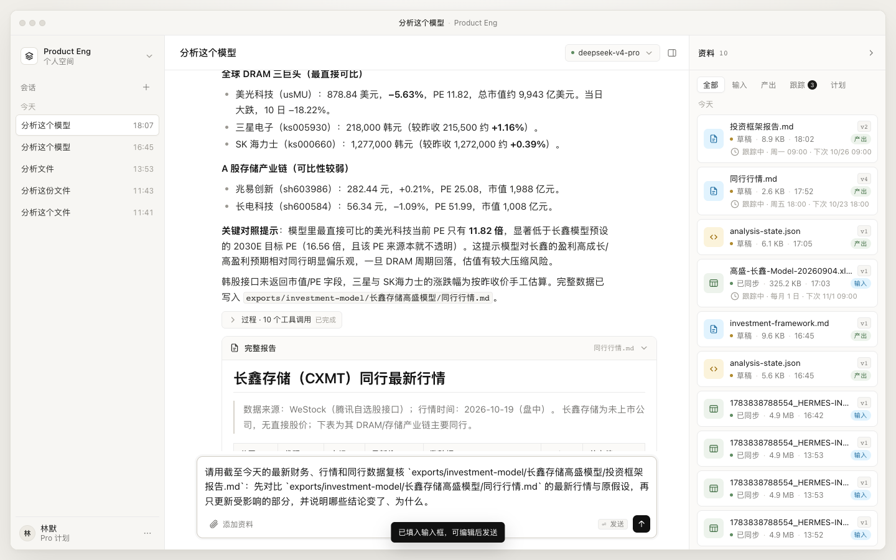

# 下一步建议：输入框上方的动态悬浮

> 状态：已实现。`suggestions.js` / `suggestions.css`，纯前端规则引擎，不额外调用模型。
> 目标：根据当前文件、上次操作、附件和跟踪状态，猜用户下一步要做什么；点击建议后，把一条可编辑的 prompt 填入输入框。

---

## 1. 需求理解

输入框上方需要一层“下一步”提示，但它不是固定快捷指令，而是随上下文变化：

- 刚进来一个估值模型 → 猜“是否要形成投资框架”；
- 已经形成投资框架 → 猜“是否要用最新行情更新”，或者“是否要纳入跟踪”；
- 已经在跟踪 → 猜“看最近一次结论”，或者“现在复核一次”；
- 刚生成了报告 → 猜“复核这份报告 / 评估是否跟踪”。

每个建议点击后**只填 prompt，不直接发送**。用户可以改完再发，保留控制权。

---

## 2. 为什么不用“每次输入都调一次模型”来判断

最佳实现不是让 LLM 在每次输入/每次渲染时猜下一步，而是：

**本地规则引擎 + 现有文件/会话元数据 + 跟踪状态 → 生成候选 → 排序 → 只展示 2–3 个。**

理由：

| 方案 | 延迟 | 成本 | 稳定性 | 适合 |
|---|---|---|---|---|
| 每次输入调 LLM | 高 | 高 | 会漂移 | 开放式对话 |
| 本地规则引擎 | 0 | 0 | 可解释、可测试 | 常见 PE 工作流 |
| 混合：规则优先，LLM 兜底 | 低 | 低 | 规则部分稳定 | 后续演进 |

PE 工作流的“下一步”高度结构化：模型 → 框架 → 更新 → 跟踪。用规则就能覆盖 80% 的场景，而且可以立刻响应文件上传、跟踪结果、SSE 更新。

后续如果要在“没有明确规则”时给更开放的建议，可以加一个**低频**的服务端 `/api/suggestions`，只在上下文发生较大变化时调用一次，并缓存结果；不要按 keystroke 调。

---

## 3. 上下文信号

实现里用了六类信号：

1. **附件**：`state.pending`，用户刚拖入/选择的文件优先级最高。
2. **上次操作的文件**：从最近消息的 `tools` 里找 `read / write / edit / workbook_query / pdf_read` 的路径，映射到 material。
3. **文件关系**：
   - `analysis-state.json` 里的 `model.files[].absolute_path` 把模型和框架目录连起来；
   - 同目录的 `投资框架报告.md`、`同行行情.md` 形成 subject group。
4. **文件类型**：`.xlsx/.xlsm` 是模型，`投资框架/framework/report.md` 是报告，`同行/行情` 是 market 文件。
5. **跟踪状态**：通过 `window.Tracking.getByFile(file)` 判断是否已跟踪、下次运行、最近结论。
6. **新鲜度**：文件 `updatedAt`；行情比报告新时，优先建议“用最新行情复核”。

排序会偏向：附件 > 上次操作 > 有报告/状态/行情的活跃 group > 最近更新 > 其他。

---

## 4. 规则表

| 上下文 | 建议 | 填入的 prompt 意图 |
|---|---|---|
| 模型 xlsx，没有 analysis-state，也没有框架 | **形成投资框架** | 解读模型、复现目标价、结合行业/同行/行情写框架 |
| 有 analysis-state，没有框架报告 | **生成投资框架** | 基于状态文件中的假设/证据/缺口生成报告 |
| 有框架报告 | **复核投资框架** | 对比最新财务/行情/同行，只改受影响部分 |
| 有框架报告，未跟踪 | **评估是否跟踪** | 给出频率、监控指标、失效条件，不直接改文件 |
| 有框架报告，已跟踪 | **查看跟踪结论** | 读最近一次跟踪记录，回答结论/变化/是否调整 |
| 有模型 + 报告 | **检查模型实际值** | 找可替换的实际值，列变更计划，不写 xlsx |
| 行情文件超过 1 天 / 只有行情 | **刷新同行行情** | 更新价格与数据日期，对比目标价假设 |
| 刚操作了一个未归类的报告 | **复核这份报告 / 评估是否跟踪** | 针对该路径生成动作 |
| 没有明确规则，但有最近文件 | **解读这个文件** | 3 句话总结结论和下一步 |

一个 group 最多出 2 条，整体最多 3 条；如果存在“活跃 group”，不会让很久以前上传的孤立模型挤掉当前上下文。



模拟待上传一个估值模型时，第一条建议会变成“形成投资框架”：



---

## 5. Prompt 生成

每条建议的 prompt 都带：

- 明确的文件路径（反引号包裹，方便 agent 精确读取）；
- 动作边界（“不要直接改 xlsx”“先不要修改文件”）；
- 期望输出（结论优先、写到哪里、给哪些内容）；
- 必要时引用关联文件（报告 + 行情 + 模型）。

例如：

```text
请用截至今天的最新财务、行情和同行数据复核
`exports/investment-model/长鑫存储高盛模型/投资框架报告.md`：
先对比 `exports/investment-model/长鑫存储高盛模型/同行行情.md` 的最新行情与原假设，
再只更新受影响的部分，并说明哪些结论变了、为什么。
```

点击后：

1. `input.value = prompt`；
2. `autosize()` + `syncComposer()`；
3. 焦点回到输入框，光标在末尾；
4. 浮层收起，提示“已填入输入框，可编辑后发送”。

不会自动发送，避免把“猜”当成“执行”。涉及“纳入跟踪”的建议也只生成评估 prompt；真正的跟踪创建仍在文件详情/跟踪面板里完成。



---

## 6. UI 行为

- 位置：`#dropZone` 内、`<form class="composer">` 上方，最大宽度与输入框一致（740px）。
- 外观：半透明白底 + 细边框 + 轻阴影，标题“猜你下一步”，右上角可收起。
- 数量：最多 3 张卡片；卡片包含图标、动作名、对象/说明。
- 隐藏条件：
  - 正在流式输出；
  - 输入框已有文字；
  - 没有候选；
  - 用户手动收起，且上下文签名没变。
- 重新出现：文件、附件、消息、跟踪状态变化后重新计算；上下文签名变化会重置“已收起”状态。
- 窄屏：卡片横向滚动，只保留动作名，详情隐藏。

---

## 7. 刷新触发点

已接入：

- `loadFoundation()` 完成资料加载；
- `upsertMaterial()` 文件新增/更新；
- `renderAttachments()` 附件变化；
- `openSession()` / `createSession()` 会话切换；
- `snapshot` / `run.settled` 会话事件；
- 开始流式输出时立即隐藏；
- `Tracking.upsert()` / `Tracking.remove()` 跟踪状态变化；
- SSE `material.updated` / `tracking.updated` 最终都会触发刷新。

---

## 8. 实现文件

- [suggestions.js](suggestions.js)：规则、分组、排序、prompt、点击填入
- [suggestions.css](suggestions.css)：悬浮层样式
- [index.html](index.html)：`#nextActions` 容器与资源引入
- [app.js](app.js)：初始化与刷新钩子
- [tracking.js](tracking.js)：暴露 `list()`，跟踪更新时刷新建议

---

## 9. 已验证

- 当前工作区会根据最近操作出现 3 条建议，例如：形成投资框架、复核长鑫框架、复核 Hermès 框架；具体顺序随文件/会话/跟踪状态变化；
- 点击“复核投资框架”后，完整 prompt 填入输入框，浮层收起，发送按钮变为可用；
- 模拟待上传的 `新的估值模型.xlsx` 后，第一条建议变为 **形成投资框架**；
- 输入文字时浮层隐藏，清空后重新出现；
- 窄屏下卡片横向滚动。

---

## 10. 后续可演进

1. **LLM 兜底排序**：当规则候选为空或用户连续忽略建议时，低频调用一次模型生成候选，缓存 5–10 分钟。
2. **行为反馈**：记录点击/忽略/发送/修改 prompt，调整每个用户的排序权重。
3. **更强的文件关系图**：把 `material_links`、`analysis-state.json`、tracking target 统一成 subject graph，减少路径启发式。
4. **多步建议**：模型 → 框架 → 更新 → 跟踪形成一条可展开的“下一步链”，而不是平铺卡片。
5. **服务端记忆**：跨设备保留 dismissed 状态和偏好。
