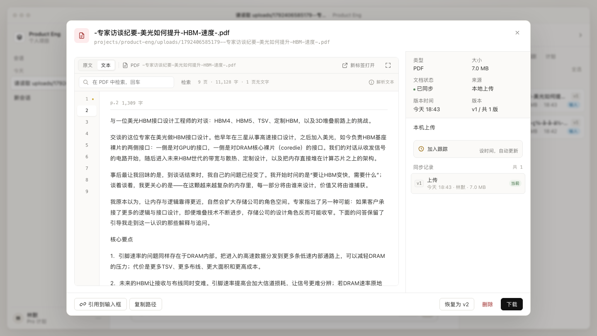

# PDF 读取（pdf_read）实现与验收

> 状态：已实现。给 Agent 加了 `pdf_read` 工具，PDF 预览加了「文本」视图。
> 不改资料/版本/计划模型；解析结果按 blob sha 复用。

## 1. 问题

Agent 的内置 `read` 只按 UTF-8 读文本，PDF 是二进制：

- 直接读会得到 50 KB 的乱码/控制字符（`read` 在 50 KB 处截断），模型无法理解；
- 让模型临时写 `python` 解析，慢、不稳定，且每次对话重复付代价；
- PDF 里的页码、章节、表格结构全部丢失，回答无法给出可核对的位置。

本项目的 Excel 已经用 `workbook_query` 解决了同类问题，PDF 按同一套架构补齐。

## 2. 方案

三层，和 workbook 完全对称：

```
POST /api/upload
  → store.indexFile()：material + version + blob(sha256)
  → pdfs.warm(id)（fire-and-forget）
        → Python 解析队列（并发 1）
        → services/pdf/parse_pdf.py <blob>
        → gzip 写 data/doc-cache/pdf/<sha>.json.gz
        → document_parses.status = ready（file_type = pdf）
        → SSE material.parsed

Agent / HTTP
  → material → version → sha
  → PdfStore.getDocument(sha)
        → 内存 LRU（2 份）→ gzip 缓存 → 解析
  → 章节 / 指定页正文 / 关键词检索（都带 p.N）
```

关键选择：

| 选择 | 原因 |
|---|---|
| **pdfplumber 为主、pypdf 兜底** | pdfplumber 对中文报告的行序和段落重组更稳；pypdf 更快，但换行/空格更碎。pypdf 还负责元数据和书签。两者都失败才报错。 |
| **按 blob sha 缓存** | 同一文件多版本、恢复旧版、重复上传只解析一次；重启后仍可用。 |
| **页级 + 段落输出** | 页码是 PDF 唯一稳定的引用单位；段落让模型读到的不是硬换行碎片。 |
| **不做 OCR** | 扫描件没有文本层，OCR 是独立依赖（tesseract / macOS Vision）。先明确标注「无文字页」，避免模型把空页当成没内容。 |
| **不做向量检索** | 单份文档、关键词 + 页码足够；检索逻辑可解释、零外部服务。 |

### 2.1 解析细节

`services/pdf/parse_pdf.py` 输出：

```json
{
  "doc": { "pages": 9, "chars": 11128, "scannedPages": [1], "parser": "pdfplumber", "version": 1 },
  "outline": [{ "title": "...", "page": 2, "level": 1 }],
  "headings": [{ "page": 2, "text": "一、HBM 有两个不同的接口", "level": 1 }],
  "pages": [
    { "page": 2, "chars": 1309, "images": 1, "scanned": false,
      "paragraphs": ["与一位美光 HBM 接口设计工程师的对谈…", "…"] }
  ]
}
```

- **段落重组**：中文按「句末标点 / 说话人 / 编号 / 短标题行」断段，其余行合并；英文断行去连字符。
- **页眉页脚**：纯页码行（`12`、`- 3 -`、`第 2 页`、`Page 2 of 9`）直接丢弃。
- **章节识别**：`一、`、`（一）`、`第 X 章`、`核心要点 / 摘要 / 风险提示` 等；同时读 PDF 书签，两者都放在大纲里。
- **扫描页**：去空白后字符数 < 12 且含图片 → `scanned: true`，在概览和读页时明确提示需要 OCR。
- **表格**：`--tables` 时才跑（pdfplumber 最慢的部分），按页返回二维数组，工具里转成 Markdown。
- **加密 PDF**：直接给「已加密，请先解除密码」的 422，不落失败缓存之外的东西。

### 2.2 在真实文件上的结果

`[专家访谈纪要] 美光如何提升 HBM 速度？.pdf`（7.0 MB，9 页，WPS 导出）：

| 指标 | 结果 |
|---|---|
| 解析耗时 | 0.33–0.54 s（首次） |
| 提取字符 | 11,128 字（pdftotext 同量级） |
| 章节 | 自动识别 10 个一级章节 + 核心要点 |
| 第 1 页 | 0 字、2 张图片 → 判定为封面/图片页，提示 OCR |
| 缓存体积 | JSON 34 KB → gzip 14 KB |
| 检索「HBM4 带宽」 | p.2 / p.4 / p.5，片段带页码 |
| 读 p.2-3 | 1,300 字/页，段落完整，可直接摘要 |

## 3. 怎么用

### Agent 工具

工具名：`pdf_read`

```json
{ "path": "uploads/1700000000000-report.pdf" }
{ "path": "uploads/…pdf", "page": "2-4" }
{ "path": "uploads/…pdf", "query": "HBM4 带宽" }
{ "path": "uploads/…pdf", "mode": "tables", "page": "3" }
```

- 默认（`mode=auto`，无 `page`/`query`）：返回页数、字符数、章节、每页首行与无文字页。
- `page`：`3` / `2-4` / `1,5-6`；单次最多 40 页；`maxChars` 默认 12,000，超出按整页截断并提示下一页。
- `query`：中文 bigram + 英文词检索；只返回真实命中，按段落给 `p.N` 片段，不返回整份文档。
- `mode=tables`：按页提取表格，转 Markdown（最多 40 张、每张 200 行 × 24 列）。
- 系统提示里明确写了：读 `.pdf` 用 `pdf_read`，引用标 `p.N`，不要用 `read` 读二进制。

### HTTP

```bash
# 文档结构 + 页级统计（首次调用会触发解析）
curl -s "localhost:8080/api/materials/<id>/pdf" | jq '{pages,chars,scannedPages,headings}'

# 带版本：读正文 / 检索
curl -s "localhost:8080/api/materials/<id>/versions/1/pdf?page=2-3" | jq -r .text
curl -s "localhost:8080/api/materials/<id>/versions/1/pdf?query=毛利率" | jq -r .text

# 检索（POST，适合前端）
curl -s -X POST "localhost:8080/api/materials/<id>/pdf/search" \
  -H 'Content-Type: application/json' -d '{"query":"风险因素"}' | jq '{pages,hits}'
```

错误：

| 状态 | 场景 |
|---|---|
| 400 | 页码格式错误、单次超过 40 页、检索词为空、tables 未给页码 |
| 404 | material 不存在；`PDF_READ=0` |
| 422 | 非 PDF、加密、损坏、上次解析失败 |
| 504 | 解析超时（120 s） |

### 前端

资料预览弹窗的 PDF 从单一 iframe 改成两个视图：

- **原文**：浏览器原生 PDF 阅读器（保留 Range、下载、新标签打开）；
- **文本**：左侧页码、右侧页正文，支持全文检索、命中高亮、无文字页提示。
  这里展示的就是 `pdf_read` 读到的内容，方便对照「Agent 看到了什么」。



## 4. 边界

- **扫描件/图片页没有文本层**：只提示、不 OCR。需要时接 macOS Vision（`swift` + `VNRecognizeTextRequest`）或 tesseract，按页缓存识别结果。
- **多栏排版**：pdfplumber 按坐标排序，双栏报告可能串行；当前以单栏报告/纪要为主，遇到再按栏切分。
- **表格**：只做规则线表格；无边框的财务表可能识别不到，需人工或后续按坐标聚类。
- **字符预算**：单次工具输出默认 12,000 字（约 8–10 页中文），避免把整份研报塞进上下文；模型应先用大纲定位再精读。
- **解析器升级**：改 `services/pdf/parse_pdf.py` 后把 `PDF_PARSER_VERSION` +1，旧缓存自动失效。

## 5. 代码清单

| 文件 | 作用 |
|---|---|
| [services/pdf/parse_pdf.py](../services/pdf/parse_pdf.py) | 生产解析器：页文本、段落、章节、元数据、书签、表格、扫描页标记 |
| [lib/pdf-store.mjs](../lib/pdf-store.mjs) | sha 缓存、gzip、SQLite 元数据、LRU、解析队列、错误映射 |
| [lib/pdf-query.mjs](../lib/pdf-query.mjs) | 页码解析、分块、中文/英文检索、大纲/正文/表格格式化 |
| [lib/pdf-tool.mjs](../lib/pdf-tool.mjs) | Pi 自定义工具 `pdf_read` |
| [server.mjs](../server.mjs) | 初始化、上传/恢复 warm、三条 API、注册工具、系统提示 |
| [app.js](../app.js) / [styles.css](../styles.css) | PDF 预览「原文 / 文本」双视图、页导航、检索高亮 |
| [scripts/test-pdf.mjs](../scripts/test-pdf.mjs) | fixture + 真实 PDF + 失败模式测试 |

## 6. 验收

```bash
npm run test:pdf
node scripts/test-pdf.mjs --file "/path/to/real.pdf"
```

测试在临时 workspace + SQLite 里跑，不碰 `data/workbench.db`；覆盖：

- 页数/字符/扫描页/章节统计；
- 大纲、指定页、字符预算截断、扫描页提示；
- 关键词检索与页码引用；
- 表格提取；
- sha 缓存命中；
- `pdf_read` 工具的路径解析、非 PDF 与文件不存在的错误。

需要 Python 3 + `pdfplumber` + `reportlab`（生成 fixture）；缺依赖时脚本 SKIP。
