# 跟踪：给产出文件加一个可持续的更新契约

> 状态：**P0 初版已接入真实后端**。SQLite `trackings / tracking_runs`、30s 调度器、真实 Pi `AgentSession`、结果契约、同文件版本提交、自动备份、SSE 更新都已跑通。
> 已真实验证：`同行行情.md` 通过跟踪运行生成 v1 → v2 → v3 → v4（每次都有备份与结果 JSON）；估值模型运行返回 `needs_review`，只生成变更计划，不写回 xlsx。
> 相关实现：`tracking.js`、`tracking.css`、`index.html`、`app.js`、`server.mjs`、`store.mjs`、`lib/tracking.mjs`。
> 相关 Skill：`skills/investment-framework/SKILL.md`（形成框架与状态）、`skills/framework-update/SKILL.md`（跟踪运行）。设计说明见 [investment-framework-skill.md](investment-framework-skill.md)。
> 相关基底：[foundation.md](foundation.md)、[pi-harness-integration.md](pi-harness-integration.md)。
> 自动监测（MON / 事件 / 通知 / 静默修订）的后续设计见 [auto-update.md](auto-update.md)。

---

## 0.1 当前已跑通的链路

```text
UI「立即运行」
  → POST /api/trackings/:id/run
  → store.startTrackingRun(base_version)
  → 备份目标文件到 backups/<timestamp>-<runId>/
  → 创建内部 Pi AgentSession（[跟踪] 前缀，不出现在左栏）
  → prompt + framework-update Skill（框架模板）
  → Agent 读取目标 / 拉数据 / 原位写回同一路径 / 追加「## 跟踪记录」
  → Agent 写 .tracking/<tracking_id>/<run_id>.json
  → agent_settled
  → 服务端校验版本是否增加、解析结果 JSON、补齐 base/result version
  → store.finishTrackingRun + 计算 next_run_at
  → broadcast tracking.updated / material.updated
  → UI 结果页与文件版本历史（v1 / v2 / v3 …）同步更新
```

- 调度器每 30s 检查 `enabled=1 and next_run_at <= now`，用 `lease_until` 防并发；错过的运行会在服务重启后按 due 状态补跑。
- 内网单进程版本；服务停掉时定时器不会运行，这是当前本地应用的边界。
- 关闭自动调度：`TRACKING_SCHEDULER=0 npm start`；手动运行不受影响。

快速验证：

```bash
curl -s localhost:8080/api/trackings | python3 -m json.tool
curl -X POST localhost:8080/api/trackings/<id>/run
# 目标文件会在同一路径生成 v2/v3…，文件详情右侧可切换版本
curl -s localhost:8080/api/materials/<target_material_id> | python3 -m json.tool
```

---

## 0. 一句话理解

这不是“再加一个计划任务”，而是给一个**已经存在的产出文件**加一份持续维护契约：

```
指定文件 + 设一个时间 + 内置更新模板
        ↓
到点自动运行一次
        ↓
新版本文件 + 结论 + 每条调整的原因 + 来源 + 未决项
```

用户只需要做三个动作里的两个：**选文件、设时间**。Prompt、工具、写回策略、验证规则都由模板和 Skill 决定。时间是这个功能唯一需要用户填的参数。

---

## 1. 需求拆解

从原始描述里可以拆出六件事：

1. **对象是产出文件，不是聊天**。文件可能已经存在、可能已经过期，也可能只是“上次分析时的快照”。
2. **跟踪是持续关系**。一次运行结束不是终点，下一次到点还要继续；所以需要状态、下次运行时间、运行记录和暂停/恢复。
3. **估值模型的更新语义**是“把已确定的实际值填进去，让受影响的预测链重算”，不是重写整个模型。
4. **投资框架的更新语义**是“用新财务、行情、同行数据重新检验原假设，再决定结论是否变化”，不是把最新事实倒灌进历史判断。
5. **结果必须结论先行**。用户不想先读一堆过程；先给“有没有调整、调整成什么”，再给“为什么调整”。
6. **可追溯**。每条调整都要有旧值、新值、依据、来源日期和影响链；没有实质变化时要明确说“无重大变化”。

### 1.1 两类文件的更新路径

| 文件类型 | 跟踪模板 | 运行时要做什么 | 写回边界 |
|---|---|---|---|
| 估值模型 `.xlsx/.xlsm` | 估值模型更新 | 读取模型结构和公式 → 找已确定实际值 → 映射到科目/期间 → 重算受影响预测与估值 | 当前工作台没有原生 Excel 写入/重算能力，生成更新副本 + `update-plan.json`，原文件保留 |
| 投资框架 `.md` | 投资框架复核 | 读取原框架和 `analysis-state.json` → 拉取新财务/行情/同行 → 对比原假设 → 更新结论与失效条件 | Markdown 可原位更新，写入前备份，生成新版本 |
| 其他文本 | 通用文件刷新 | 按文件自身结构刷新受影响内容 | 只写文本，保留原结构 |

### 1.2 结果页的信息顺序

```
结论（目标价/判断有没有变）
  → 关键数字（旧 → 新）
  → 判断变化（哪些边界变了）
  → 为什么调整（3–5 条，带来源和影响）
  → 写回了什么（版本、假设/预测/结论各改了几处）
  → 数据与来源（截止日期、未使用项）
  → 运行记录
```

这个顺序是刻意的：**先回答“我需不需要看”，再回答“为什么”**。

---

## 2. UI：落在现有应用里的位置

### 2.1 入口

- 右侧资料面板新增 **跟踪** 筛选，并显示跟踪数量。
- 文件详情弹窗底部新增 **加入跟踪 / 跟踪中** 条；未跟踪文件直接从这里建立跟踪。
- 普通文件卡片在已跟踪时显示 `跟踪中 · 周一 09:00 · 下次 10/26 09:00`。
- 跟踪面板右上角 `+` 可以新建跟踪。

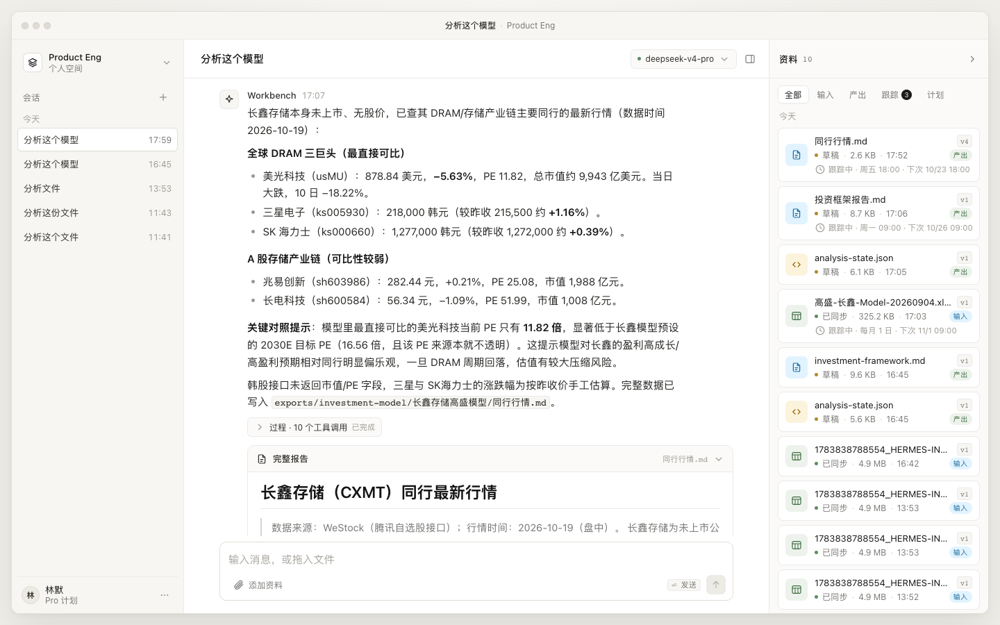

### 2.2 建立跟踪

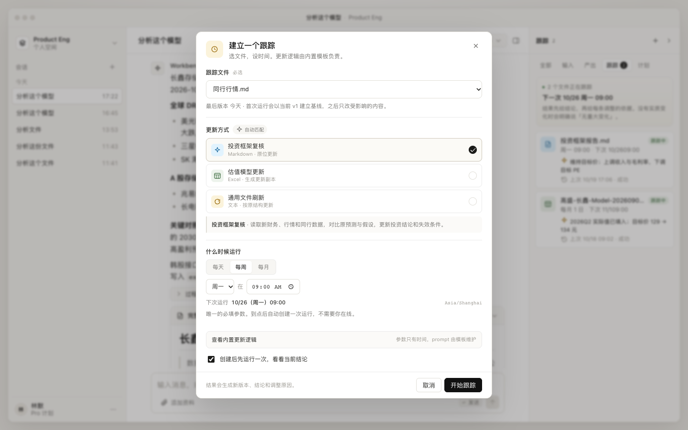

设置项只有三块：

1. **跟踪文件**：显示路径、当前版本、最后更新时间、是否已跟踪。已跟踪文件会直接跳到现有跟踪，不重复创建。
2. **更新方式**：按文件类型自动匹配，展示三个内置模板；选中模板的说明和完整 prompt 可展开查看，但不需要编辑。
3. **什么时候运行**：每天 / 每周 / 每月 + 时间；显示下次运行和时区。这是唯一必填参数。

可选项只有一个：**创建后先运行一次**，用于立刻看到当前结论或建立基线。

建立之后只改时间，不会改更新逻辑：

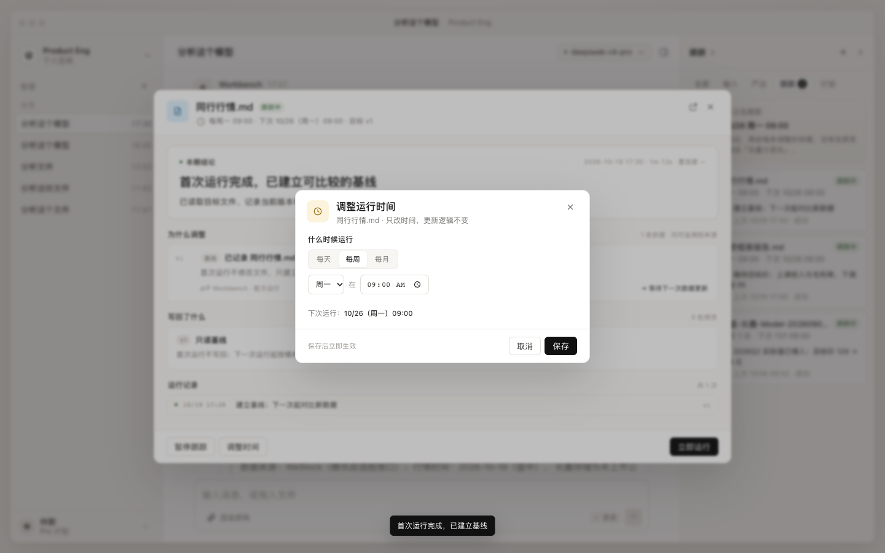

### 2.3 跟踪中心

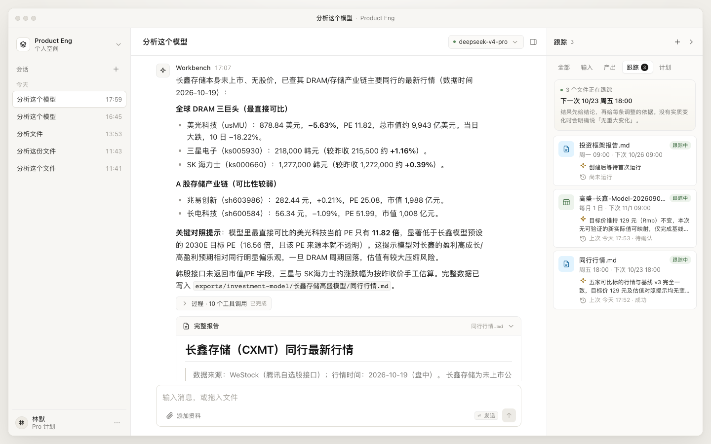

每个跟踪卡片先给：目标文件、状态、频率、下次运行、最近一次结论、上次运行结果。点开进入结果页。

### 2.4 结果页

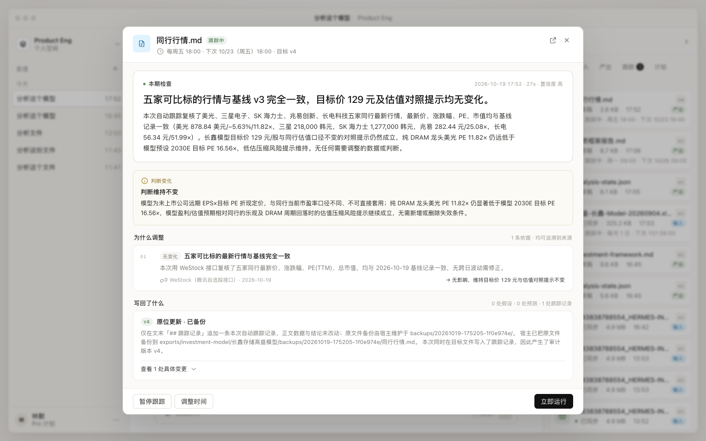

结果页从上到下：

- 本期结论（大字） + 关键数字变化（目标价、收入、毛利率、目标 PE）。
- 判断变化：判断有没有反转、新增/删除了哪些失效条件。
- 为什么调整：每条一行，包含类型、结论、解释、来源、影响。
- 写回了什么：版本、模式（原位/副本/只读）、改动统计、可展开的具体变更表。
- 数据与来源：带日期的来源 chip，以及“未使用”的项。
- 运行记录：最近 5 次，每次一行结论。

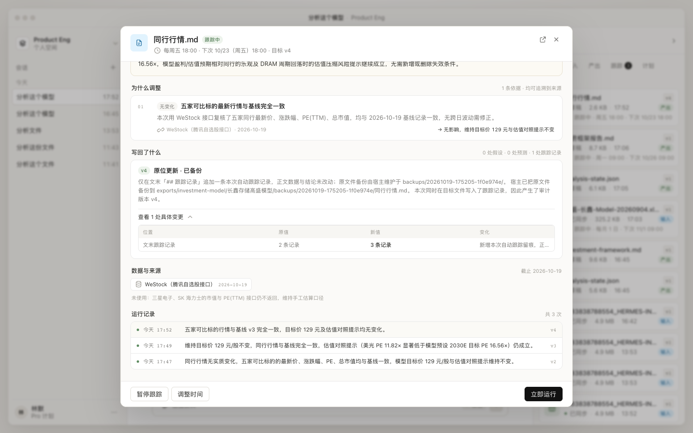

如果最近一次运行没有实质变化，结果页会显示“本期检查”，结论明确说“无重大变化”，同时目标文件因追加 `## 跟踪记录` 产生一个审计版本。真实结果示例：

```text
本期检查 · 2026-10-19 17:52 · 27s · 置信度 高
五家可比标的行情与基线 v3 完全一致，目标价 129 元及估值对照提示均无变化。
写回了什么：v4 · 原位更新 · 已备份
```

这与“有变化的结论”是同一套结果结构，不另做一个横幅。用户可以点开 v4 / v3 / v2 / v1 对比。

Excel 模型的运行结果会显示“等待确认”，不产生原文件的新版本：

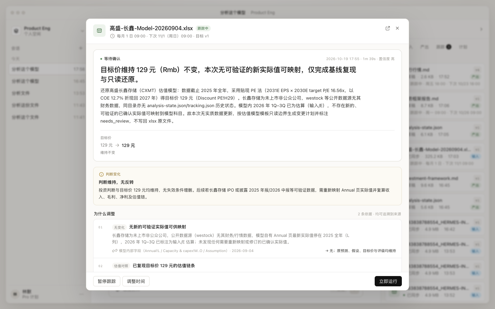

### 2.5 其他状态

| 状态 | UI |
|---|---|
| 等待首次运行 | 结果页提示“还没有可比较的结论”，可立即运行或等下次 |
| 运行中 | 4 步进度：读文件 → 拉数据 → 对比假设 → 写回并生成结论；服务端运行，关闭窗口不中断 |
| 首次运行 | 真实运行，正常产生结论与版本；不是只读基线 |
| 暂停 | 卡片和结果页都显示“已暂停”，下次运行置空；可随时恢复 |
| 失败 | 运行记录标失败，保留错误信息；不覆盖旧版本 |
| 等待确认 | Excel/重大判断用 `needs_review`，有结果但没有新版本 |

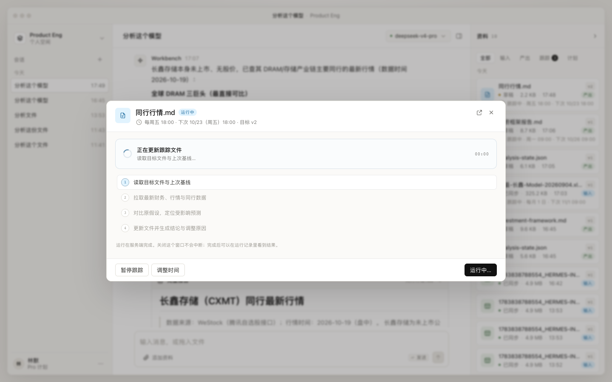
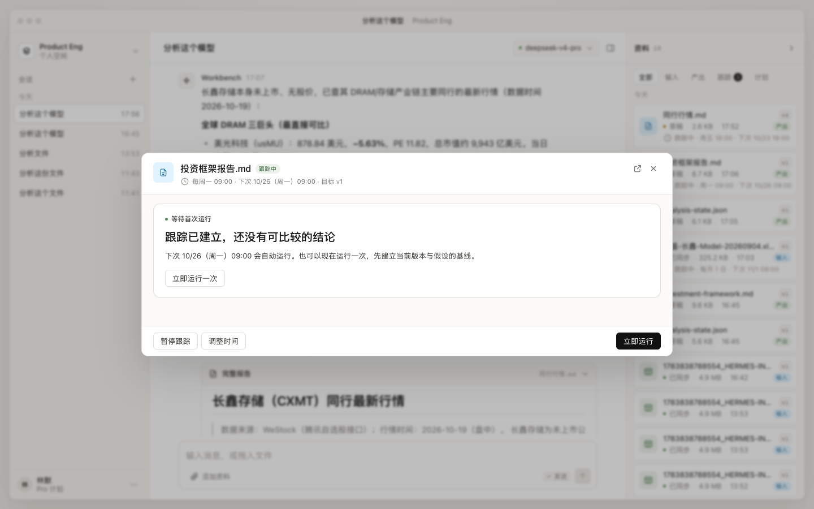

### 2.6 文件详情里的跟踪条

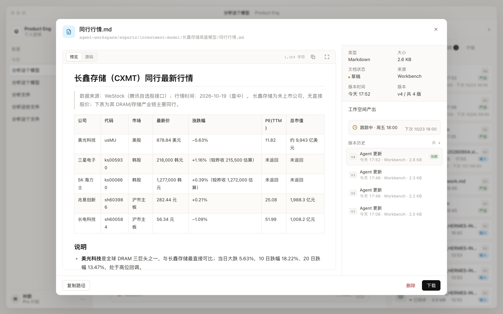

已跟踪：`跟踪中 · 周一 09:00 · 下次 10/26`。
未跟踪：`加入跟踪 · 设时间，自动更新`。

---

## 3. “进入跟踪以后，是不是一个定时器去调用 Pi harness？”

**是，但“定时器”只是最外层。** 准确的分层是：

```
持久化调度器（到点唤醒）
   → 运行队列（幂等、加锁、重试）
   → Pi AgentSession（一次运行一个内部会话）
   → Skill / 模板 / 工具 / 文件契约（约束 agent 怎么做）
   → 结果契约校验
   → 版本提交 + 运行记录 + SSE 通知
```

### 3.1 为什么不能是前端定时器

| 前端 `setTimeout` | 服务端调度器 |
|---|---|
| 关掉页面/合上电脑就停 | 只要服务在跑就会触发 |
| 多标签页会重复触发 | 单写者 + lease 保证一次只跑一个 |
| 没有运行记录 | 每次运行可审计、可重试 |
| 无法处理错过的运行 | 启动时补跑或标记 missed |
| 无法限制成本 | 可以做预算、并发和超时 |

当前 `server.mjs` 已经有 `plans`、`next_run_at`、`plan_runs`（旧计划任务仍手动运行）；跟踪域新增了 `trackings / tracking_runs` 和 30s 调度器，见第 5.1 节。

### 3.2 一次跟踪运行的完整链路

```text
1. Scheduler tick（30s）
   select * from trackings
   where enabled=1 and next_run_at <= now
     and (lease_until is null or lease_until < now)
   → claim（lease_until = now + 10min，单写者）

2. Preflight
   - 目标文件存在？
   - 上次运行是否还在 running？服务重启时把中断 run 标 failed
   - 本次基线版本 = 目标文件当前最新版本
   - 备份目标文件到 backups/<timestamp>-<runId>/
   - 成本/并发预算：初版尚未实现

3. 创建内部 Pi 会话
   - cwd = agent-workspace
   - 只加载工作空间内 Skill（现有 skillsOverride 逻辑）
   - 注册 read/write/edit/grep/find/ls + workbook_query + westock_query
   - 标题：「跟踪」<文件名>，不出现在左栏会话列表

4. 组装输入
   - 模板 prompt（当前内置在 lib/tracking.mjs）
   - 目标文件 + 同目录 analysis-state.json（存在时）
   - 基线版本、备份路径、结果 JSON 路径
   - 写回策略、目录约束、结果 schema
   - 允许使用的数据源与截止日期

5. Agent 执行
   - 读基线 → 找新数据 → 对比假设 → 原位写回同一路径（追加跟踪记录）
   - 输出 tracking-result.json + 变更说明 + 更新后的文件
   - 回复正文：结论 + 为什么调整（聊天里不重复整篇报告）

6. 结果校验（服务端，不信任 agent 自述）
   - result JSON 是否合法；不合法则退化为运行回复摘要
   - 目标 material 版本是否真的增加
   - 若 Agent 说 updated 但没有新版本 → needs_review
   - 是否越权写了二进制 → 模板边界拦截
   - 备份路径是否存在
   - 内容指纹：初版尚未计算

7. 提交
   - material_versions 新版本（同路径）
   - tracking_runs 写入 status / result_version / result_json / message
   - trackings.next_run_at 推进
   - SSE 推送 tracking.updated；目标文件复用 material.updated

8. 通知
   - 右栏卡片、结果页、运行记录更新
   - 可选：系统通知 / 邮件 / IM
```

### 3.3 调度器的关键约束

- **单写者**：同一 workspace 的调度只能有一个进程；用 SQLite lease 或文件锁。当前应用是单进程 Node，可以先做 30s 循环 + 内存忙锁，但重启恢复要靠 DB。
- **幂等**：`(plan_id, scheduled_for)` 唯一；重复触发只产生一次 run。
- **错过运行**：启动时检查 `next_run_at < now`；按策略补跑一次或标记 `missed`，不要一次补 10 次。
- **超时**：每次 run 有 `max_runtime`；`agent_settled` 才算结束（Pi 的 `agent_end` 不是终态）。
- **重启恢复**：启动时把 `running` 且超过 lease 的 run 标 `failed`，保留现场，不覆盖文件。
- **预算**：每次 run 记录 token/cost；单次上限 + 每日上限；超限不启动，给出原因。
- **时区**：所有 `next_run_at` 存 UTC，展示用 `Asia/Shanghai`；金融数据还要考虑交易日/披露日。

### 3.4 本地应用的特殊问题

Workbench 现在是本地 Node 服务。如果用户合上 Mac，调度器不会运行：

- 服务重启后补跑一次（推荐默认）；
- 或用 macOS `launchd` 定时唤醒 Node；
- 或把调度放到常驻服务/云端，Workbench 只负责查看结果；
- UI 必须明确显示“上次运行 / 下次运行 / 服务是否在线”，不能让用户以为后台一定在跑。

当前实现的调度器开关：默认开启 30s tick；设置 `TRACKING_SCHEDULER=0` 可关闭自动触发，手动「立即运行」仍然可用。

---

## 4. 你负责什么，系统负责什么

你提出的分工是对的：**你做 Skill、文件格式、metadata、目录约束；agent 自己做更新。** 但要再加一层“系统负责调度与验收”。

| 角色 | 负责 |
|---|---|
| 你 | Skill 的更新方法、文件格式、metadata 字段、目录约定、什么算重大判断、什么需要人工确认 |
| 调度器 | 到点触发、幂等、锁、超时、重试、预算、错过运行 |
| 模板 | 把 Skill + 文件契约 + 输出 schema 固化成可版本化的 prompt / tool policy |
| Pi harness | 模型调用、agent loop、工具执行、会话事件 |
| 结果校验器 | schema、版本、来源、写回边界、备份、指纹 |
| UI | 结论、原因、来源、版本、运行记录；不替用户做判断 |

一句话：**Agent 不负责“什么时候跑”，也不应该自己声明“我更新成功了”；调度器负责前者，校验器负责后者。**

---

## 5. 数据契约

### 5.1 调度层：独立的 `trackings / tracking_runs`（P0 实现）

初版没有直接改 `plans`，而是新增两张表，避免影响现有“计划”接口；调度逻辑和 `plans.next_run_at` 是同一套思路。后续如果要把“计划”和“跟踪”合并成一种调度对象，再把字段并回 `plans` 即可。

```sql
create table trackings (
  id text primary key,
  workspace_id text not null,
  name text not null,
  target_id text not null references materials(id) on delete cascade,
  template_id text not null,
  schedule_label text not null,
  freq text not null,              -- daily | weekly | monthly
  at_time text not null,           -- HH:mm
  weekday integer,
  day integer,
  timezone text not null default 'Asia/Shanghai',
  enabled integer not null default 1,
  next_run_at text,
  last_run_at text,
  lease_until text,                -- 30s 调度器的单写者租约
  created_at text not null
);

create table tracking_runs (
  id text primary key,
  tracking_id text not null references trackings(id) on delete cascade,
  trigger text not null default 'schedule', -- schedule | manual
  started_at text not null,
  ended_at text,
  status text not null,            -- running | updated | no_change | needs_review | failed
  base_version integer,
  result_version integer,
  result_json text,                -- tracking-result.json 的规范化快照
  message text,
  session_id text,                 -- 内部 Pi AgentSession
  scheduled_for text
);

create index idx_trackings_next on trackings(enabled, next_run_at);
create index idx_tracking_runs on tracking_runs(tracking_id, started_at desc);
```

对应的 API：

| 方法 | 路径 | 说明 |
|---|---|---|
| GET | `/api/trackings` | 列表 + 目标文件 + 最近结果 + 运行记录 |
| POST | `/api/trackings` | 创建；一个目标文件只允许一个跟踪 |
| POST | `/api/trackings/:id/toggle` | 暂停 / 恢复 |
| PATCH | `/api/trackings/:id/schedule` | 只改频率/时间 |
| POST | `/api/trackings/:id/run` | 真实运行（内部 Pi 会话） |
| DELETE | `/api/trackings/:id` | 删除跟踪（不删文件历史） |

SSE 新增 `tracking.updated` / `tracking.deleted`；目标文件写入仍复用 `material.updated`。

### 5.2 文件层：DB + `.tracking/`，sidecar 是下一步

初版没有给每个文件写 `tracking.json` sidecar；跟踪配置和运行记录在 SQLite，结果 JSON 写到工作区内的隐藏目录：

```
exports/investment-model/长鑫存储高盛模型/
├── 投资框架报告.md
├── analysis-state.json
└── backups/
    └── 20261019-1706-a1b2c3d4/
        └── 投资框架报告.md

.tracking/<tracking_id>/
├── <run_id>.json                 # 规范化后的 tracking-result
└── <run_id>/                     # Excel 模板的变更计划
    ├── update-plan.json
    └── change-log.md
```

`.tracking/` 和 `backups/` 都被排除在资料索引之外，不会出现在右栏文件列表里。

下一步建议给被跟踪文件加 sidecar，用于记录跨运行的文件语义：

```
exports/investment-model/长鑫存储高盛模型/
├── 投资框架报告.md
├── analysis-state.json
└── tracking.json                  # 建议：文件级语义与基线
```

`tracking.json` 示例：

```json
{
  "schema": "pe.tracking.file/v1",
  "template": "investment-framework",
  "subject": "长鑫存储",
  "target": "投资框架报告.md",
  "baseline_version": 3,
  "baseline_fingerprint": "sha256:…",
  "valuation_date": "2027-01-01",
  "actuals_through": "2025-12-31",
  "watch": ["financials", "market", "peers"],
  "write_policy": "in_place_markdown_with_backup",
  "outputs": ["update-plan.json", "change-log.md"],
  "last_reviewed_at": "2026-10-19T09:04:00+08:00",
  "open_questions": [
    "2030E 目标 PE 的来源不透明"
  ]
}
```

为什么是 sidecar：

- 不改动报告正文，避免跟踪元数据污染投资结论；
- 可以被 agent、调度器、UI 同时读取；
- 可以独立演进 schema；
- 文件被复制/移动时，sidecar 跟着目录走。

### 5.3 运行结果契约：`tracking-result.json`

这是 UI 直接消费的对象，也是校验器的输入。Agent 必须先写这个文件，再回复用户；服务端不解析自然语言。

```json
{
  "schema": "pe.tracking.result/v1",
  "tracking_id": "trk-framework-cxmt",
  "status": "updated",
  "target": {
    "path": "exports/investment-model/长鑫存储高盛模型/投资框架报告.md",
    "base_material_id": "da477dd3-…",
    "base_version": 1,
    "result_material_id": "da477dd3-…",
    "result_version": 2,
    "write_mode": "in_place",
    "content_fingerprint": "sha256:…"
  },
  "conclusion": "维持 129 元目标价；盈利上调被估值倍数下调抵消",
  "deltas": [
    { "label": "目标价", "from": "129 元", "to": "129 元", "note": "0.0%" },
    { "label": "2026E 收入", "from": "3,549 亿", "to": "3,729 亿", "note": "+5.1%" }
  ],
  "reasons": [
    {
      "id": "R1",
      "type": "new_actual",
      "title": "2026Q2 收入 128.4 亿，高于原预测 6.8%",
      "detail": "差异主要来自 HBM ASP 与出货量，不是一次性项目。",
      "source": { "name": "公司 2026 半年报", "date": "2026-08-28", "locator": "…" },
      "impact": "2026E 收入 +5.1%"
    }
  ],
  "judgment": {
    "changed": false,
    "text": "维持「HBM 放量是核心驱动」；新增失效条件：2027E HBM 收入 < 500 亿元。"
  },
  "writeback": {
    "mode": "in_place",
    "backup": "backups/2026-10-19-1706/投资框架报告.md",
    "verified": false,
    "note": "文本已写回；未做原生 Excel 重算"
  },
  "sources": [
    { "name": "公司 2026 半年报", "date": "2026-08-28" },
    { "name": "同行行情", "date": "2026-10-16" }
  ],
  "open_questions": ["2026Q3 业绩尚未披露"],
  "not_used": ["2026Q3 业绩（尚未披露）"]
}
```

`status` 枚举：

- `updated`：有新版本，且至少一条有效调整；
- `no_change`：检查完成，但没有需要调整的内容；
- `needs_review`：agent 认为涉及重大判断，等待人工确认；
- `failed`：失败，未写回；
- `baseline`：首次运行，只建立基线。

### 5.4 目录与写回约束

- 工作区根目录：`agent-workspace/`。
- `inputs/`、`uploads/` **只读**。
- 产出、备份、运行结果统一放 `exports/<domain>/<subject>/`。
- 原位更新只允许 `.md` / `.markdown` / `.txt`。
- `.xlsx/.xlsm`：只读解析，生成更新副本和变更清单；不得用 `write`/`edit` 直接改二进制。
- 写入前备份；记录内容指纹；没有哈希工具时明确标注 `unavailable`，不能假装验证过。
- 没有原生重算时，`verified` 必须为 false，并在结果页写清楚。

### 5.5 版本语义：同一文件的 v2，还是新文件副本？

这是跟踪设计里最容易混淆的一点。**并不是所有“产出新文件”都应该表现为原文件的 v2。**

| 写回模式 | 文件身份 | 用户看到 | 适用 |
|---|---|---|---|
| `in_place` | 同一个 `material`，同一个路径 | 文件详情的版本历史出现 `v1 → v2`，可以点选切换、预览、恢复 | Markdown / 文本 |
| `update_copy` | 新的 `material`，新的路径 | 原文件仍是 v1，新增一张“更新副本”文件卡片；需要 lineage 关联 | Excel / 二进制，或需要保留原件 |
| `propose_only` | 原文件不变 | 只有变更计划和 `update-plan.json`，没有新版本 | 不能安全写回时 |

结论：

- **只有 `in_place` 会出现在原文件的版本列表里。** 这时“选到 v1 / v2 切换”是天然成立的：`material_versions` 已经按 `v` 保存每个 blob，文件详情右侧的版本历史就是切换入口；恢复旧版会再生成一个新版本，而不是改写历史。
- **`update_copy` 不要伪装成原文件的 v2。** 它应该是一个独立文件，结果契约里同时记录 `base_material_id / base_version` 和 `result_material_id / result_path`，UI 显示“原文件”和“更新副本”两个入口。否则用户会以为原文件被更新了，实际上只是旁边多了一个副本。
- **Excel 当前属于 `propose_only`**：工作台没有原生 Excel 写入/重算能力，因此不能承诺“原 xlsx 的 v2”。初版生成 `update-plan.json` / `change-log.md`，不生成二进制副本，也不在 lineage 里伪装成新版本。
- **结果页应该把版本说清楚**：写回卡片显示 `基线 v1 → 更新 v2`，两个版本都可以点开；如果是副本，则显示“原文件 v1 / 更新副本”而不是版本箭头。

初版已经验证：`同行行情.md` 连续运行时生成 v2 / v3 / v4，文件详情右侧列出全部版本；点选旧版即可预览和恢复。跟踪结果页的“打开目标文件”会优先打开 `result_version` 对应的版本。

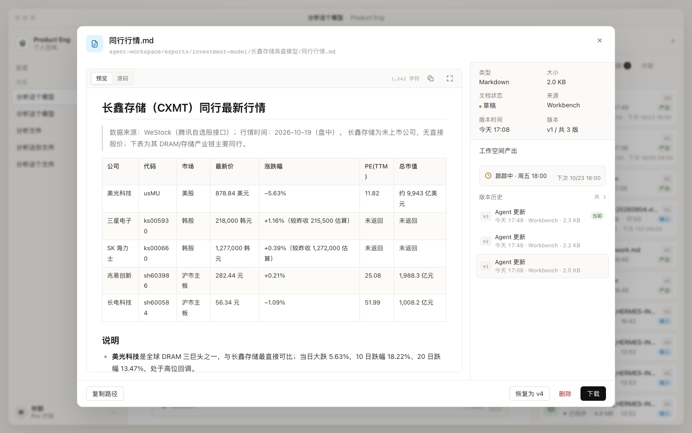

---

## 6. Skill / 模板怎么配合

投资框架使用两个仓库级 Skill（位于 `skills/`，随产品分发；项目也可在 `.agents/skills/` 放自定义 Skill）：

- `investment-framework`：形成七节报告，并落盘 `analysis-state.json`——观点 T、假设 A、敏感性 S、失效条件 F 一一关联；
- `framework-update`：跟踪运行专用，逐条核对失效条件，只改受影响部分，回写状态与报告，输出含 `theses` / `invalidations` 的结果 JSON。

`model` / `generic` 模板没有专用 Skill，依靠 `lib/tracking.mjs` 里的领域规则和结果契约。

跟踪模板不复制这些 Skill 的全部内容，而是做三件事：

1. **选择 Skill**：`investment-framework` → framework-update；`valuation-model` / `generic` → 按模板领域规则执行。
2. **注入上下文**：目标文件、基线版本、同目录 `analysis-state.json`、备份路径、允许的数据源、写回策略。
3. **约束输出**：必须写 `.tracking/<id>/<run_id>.json`；聊天里只给结论摘要；报告放 `exports/`。

模板本身应该版本化（`template_version`），否则无法解释“为什么上周和这周的判断不同”。模板变更也要能在运行记录里看到。

---

## 7. 状态机

```text
                 ┌──────────────┐
                 │   scheduled  │
                 └──────┬───────┘
                        │ due / manual
                        ▼
                 ┌──────────────┐
                 │   running    │
                 └──┬───┬───┬───┘
          updated   │   │   │ failed
                    ▼   │   ▼
              ┌────────┐│ ┌────────┐
              │ updated││ │ failed │
              └────────┘│ └────────┘
                        │ no_change / needs_review / baseline
                        ▼
                 ┌──────────────┐
                 │   settled    │──→ 计算 next_run_at
                 └──────────────┘
```

- 失败不会覆盖旧版本；下一次仍按计划运行。
- `needs_review` 不自动推进结论，但仍推进 `next_run_at`；UI 给出待确认提示。
- 暂停只是 `enabled=0`，不删除历史。

---

## 8. 落地顺序

### 已完成（P0 初版）

1. `trackings / tracking_runs` 表与 `/api/trackings` 全套接口。
2. 30s 调度循环 + `lease_until` + running 恢复。
3. 三个内置模板 + 文件类型自动匹配。
4. 真实 Pi `AgentSession` 运行：目标文件 + Skill + 结果契约。
5. Markdown 原位写回、同路径版本提交、自动备份。
6. Excel 只读边界 + `update-plan.json` / `change-log.md` + `needs_review`。
7. SSE `tracking.updated` / `tracking.deleted` + 前端实时更新。
8. 前端从 localStorage 切到 `/api/trackings`。

### 下一步（P1）

- 调度器到点实跑验证（当前只手动触发过真实运行）。
- 失败重试/退避、单次与每日成本上限。
- 通知（系统通知/IM）。
- `needs_review` 的审批 UI 与阻断策略。
- 运行日志按 tracking 归档、模板版本可见。
- 运行中取消（abort）按钮，复用 Pi 的 abort。

### 后续（P2）

- 多文件/依赖图：模型更新后自动触发框架复核。
- 数据源订阅：财报日历、行情、同行数据库。
- 文件级 `tracking.json` sidecar 与跨运行语义。
- 自动生成“本周组合跟踪摘要”。

## 9. 待确认的产品决策

1. **运行频率**：金融数据有交易日和披露日。只给“每周一 09:00”够不够，还是需要“交易日收盘后”“财报披露后 24h”？当前 UI 按用户要求只暴露时间。
2. **错过运行**：Mac 睡眠后，是补跑一次，还是直接跳到下一次？
3. **Excel 写回**：只生成副本，还是未来接入 LibreOffice/Excel 重算后原位更新？在能力具备前，UI 必须保持“副本/未验证”的诚实标签。
4. **重大判断**：目标价变化超过多少、评级变化、失效条件变化，需要人工确认？这是模板级参数，不应该让用户每次填。
5. **通知**：结果只出现在 Workbench，还是需要系统通知/邮件？
6. **成本**：单次运行预算和每日预算；超限是跳过、降级模型，还是等用户确认？

---

## 10. 当前实现边界

### 已跑通（P0 初版）

- SQLite `trackings / tracking_runs` 持久化；一个目标文件只允许一个跟踪；
- 30s 调度器 + `lease_until` 防并发；服务重启时把中断的 running 标失败并释放租约；
- 真实 Pi `AgentSession`：内部会话标题 `[跟踪]`，不出现在左栏；
- 三个内置模板 + 自动匹配；`framework-update` Skill 约束状态与结果契约；
- Markdown 原位更新：同一路径产生 v1 → v2 → v3；服务端自动备份到 `backups/<timestamp>-<runId>/`；
- Excel 只读：生成 `update-plan.json` / `change-log.md`，状态 `needs_review`，原 xlsx 不产生新版本；
- `tracking-result.json` 规范化：结论、数字、判断变化、原因、来源、写回、未使用项；框架模板额外包含观点状态（`theses`）与失效条件核对（`invalidations`）；
- UI：结论优先、版本切换、暂停/恢复、改时间、运行记录、SSE 实时更新；
- 真实验证：`同行行情.md` 连续生成 v2/v3/v4；`高盛-长鑫-Model` 返回 needs_review。

### 尚未做（下一步）

- **调度器到点实跑验证**：本轮验证均为手动触发；30s tick 已启动，但“到点自动运行”尚未实测；
- **重试/退避/成本上限**：失败只记录，不自动重试；没有 token/费用预算；
- **通知**：结果只回到 Workbench，没有系统通知/邮件；
- **重大判断审批门**：`needs_review` 目前只是状态，不阻塞下一次运行，也没有审批 UI；
- **错过运行策略**：重启后 due 的会补跑一次，但没有“最多补几次”的配置；
- **Excel 副本**：Agent 生成更新计划和变更日志，但没有生成二进制 xlsx 副本（工作台没有 Excel 写入能力）；
- **多文件依赖**：模型更新后自动触发框架复核还未实现；
- **鉴权/多用户**：仍是本地单人应用。

> 当前版本已经满足“一个文件身份 + 多个版本”：Markdown 跟踪写回同一路径，文件详情右侧会列出 v1 / v2 / v3 …，点选即可切换预览；Excel 仍保持只读，不伪装成原文件的新版本。
